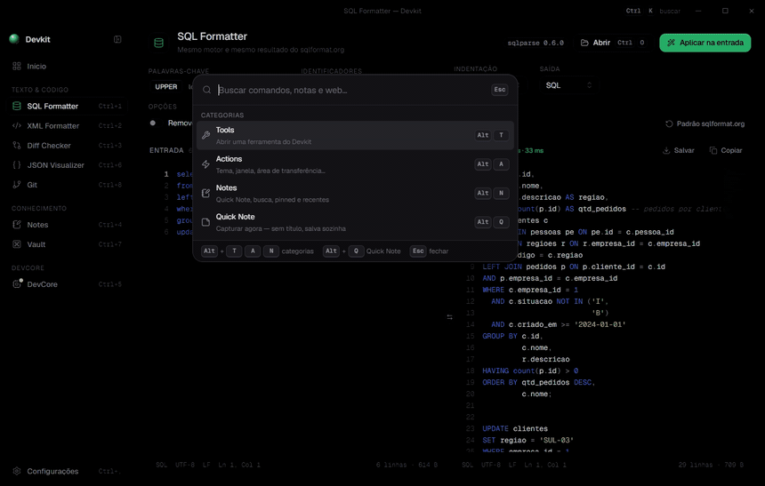
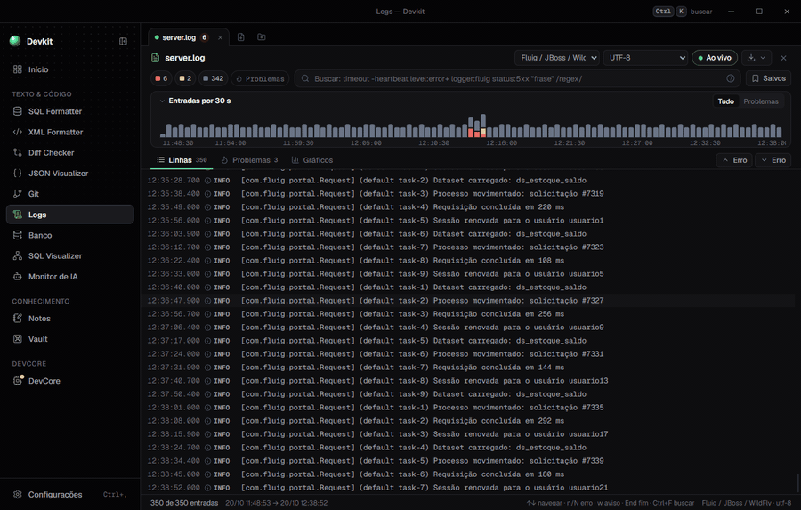
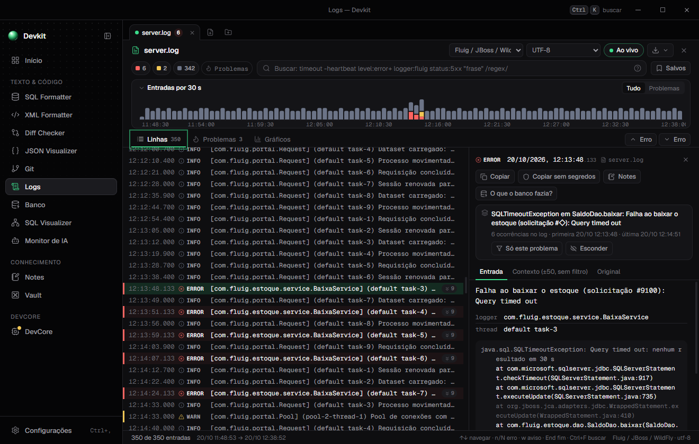
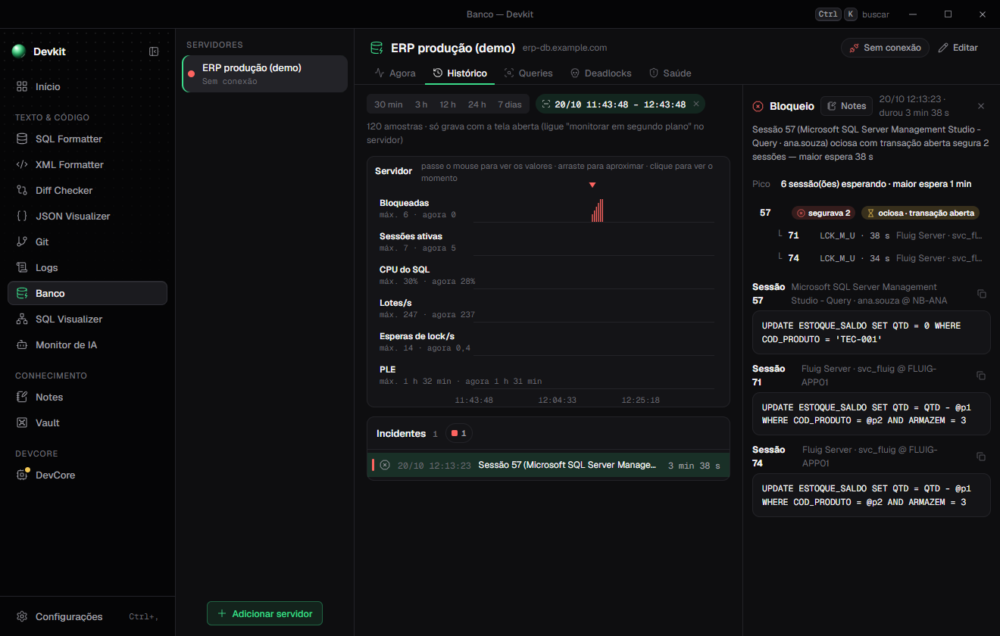
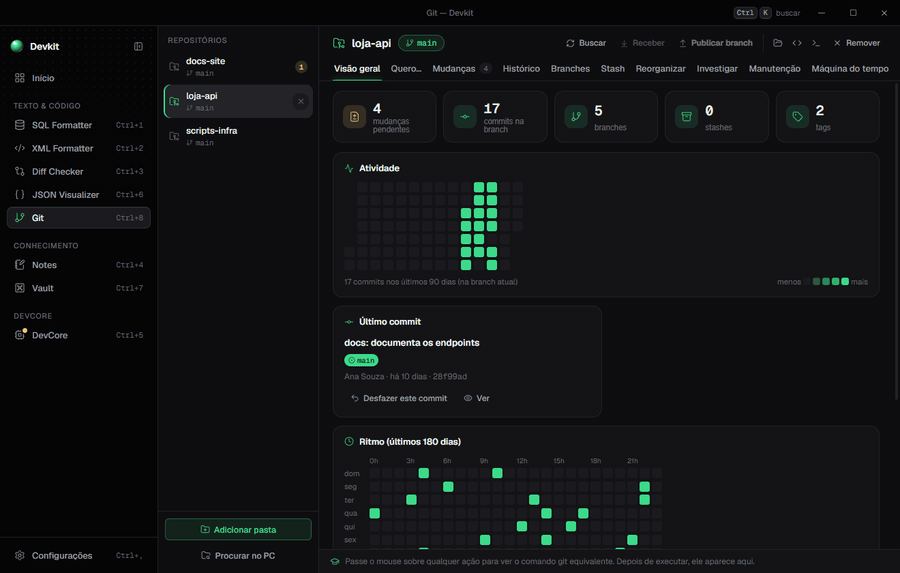
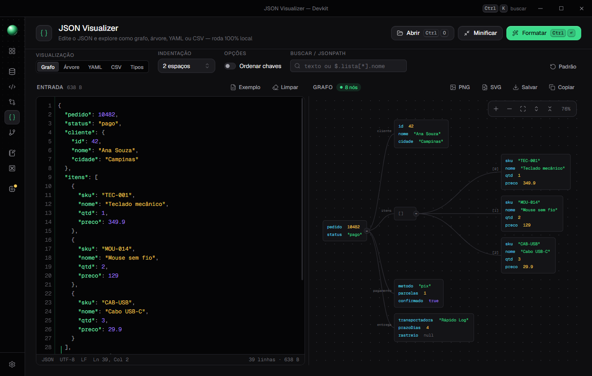
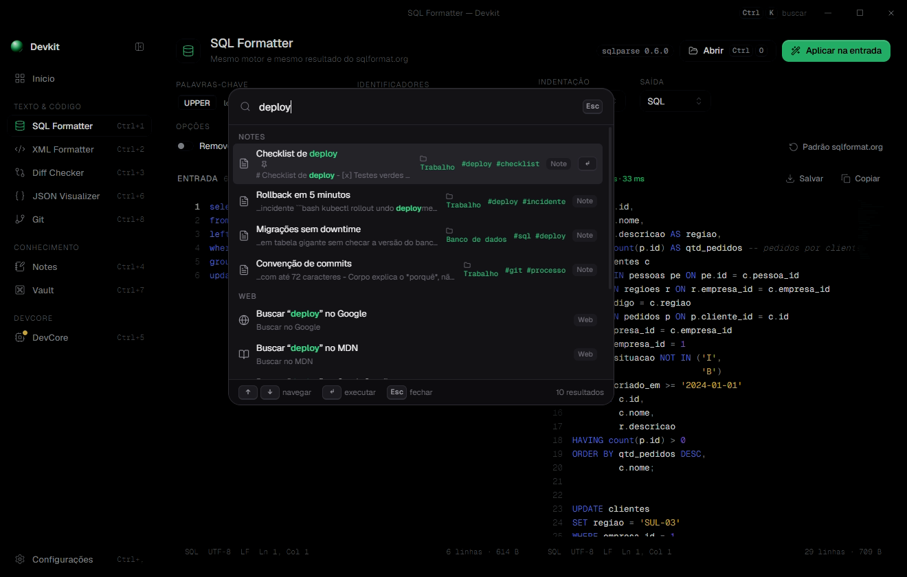
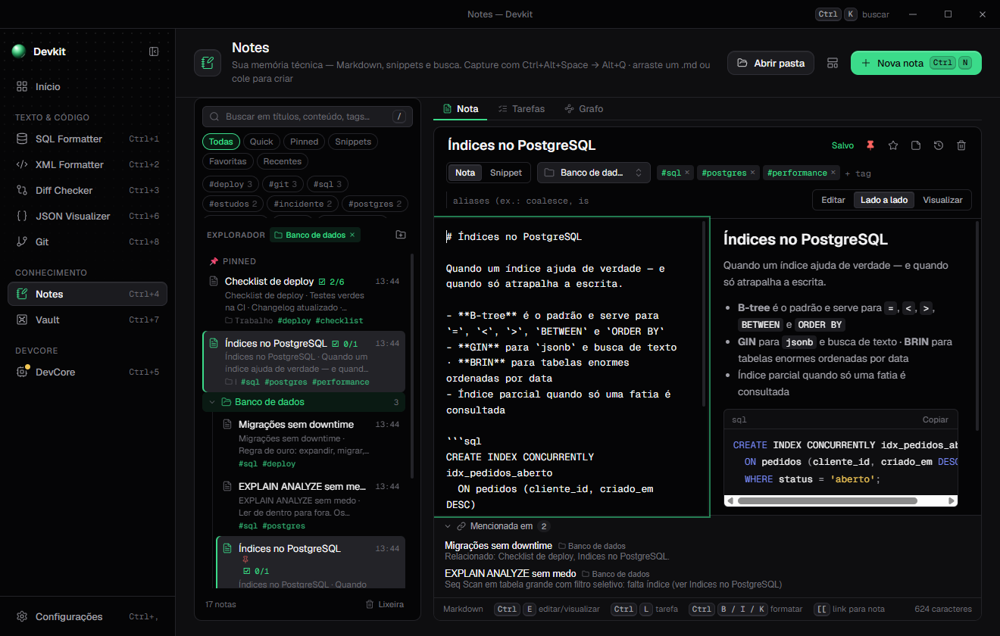
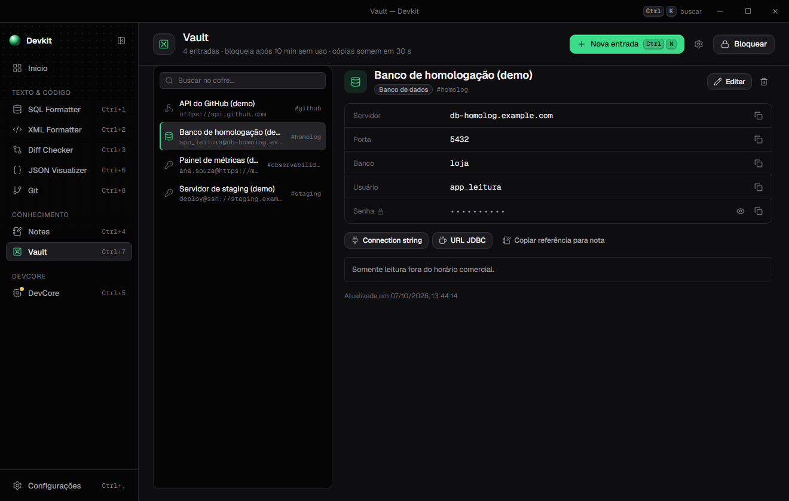
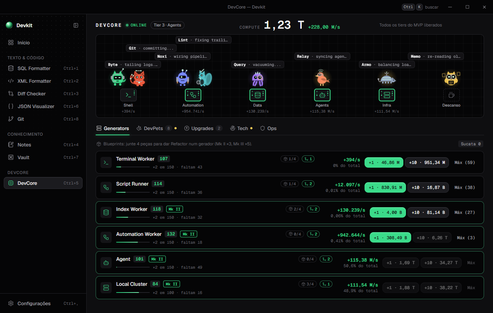

<div align="center">


# Toni Devkit

**Toolkit desktop offline para devs: Git visual, monitoramento de SQL Server, análise de logs, ferramentas de JSON e uma palette global.**
Formatadores, notas e cofre também, num app só.

[](https://github.com/tonissx/toni-devkit/releases/latest)
[](LICENSE)


[Baixar](#instalação) ·
[Guia completo](docs/FEATURES.md) ·
[English](README.en.md)



</div>

---

## Veja em ação

### Do erro no log ao bloqueio no banco, em um clique

Um timeout aparece no `server.log`. Em vez de abrir o SSMS e adivinhar, **"O que o banco fazia?"** abre o histórico do
SQL Server naquele horário. Aqui, uma transação esquecida (`BEGIN TRAN` sem `COMMIT`) segurando as outras sessões.



<sub>Dados fictícios, gerados por script (`npm run docs:capture`).</sub>

1. **Logs** abre o `server.log`, agrupa os 6 timeouts como **um problema só** e mostra o pico na linha do tempo.
2. **O que o banco fazia?** pula para o **Banco** no mesmo minuto, a partir do histórico que o monitor gravou.
3. O incidente mostra a **árvore de bloqueio**: a sessão ociosa com a transação aberta no topo e quem ficou esperando.

<table>
  <tr>
    <td width="50%"></td>
    <td width="50%"></td>
  </tr>
  <tr>
    <td align="center"><sub>Logs: o erro certo em segundos</sub></td>
    <td align="center"><sub>Banco: quem segurava quem</sub></td>
  </tr>
</table>

---

## Instalação

[**⬇ Baixar a versão estável mais recente**](https://github.com/tonissx/toni-devkit/releases/latest) — o selo no topo
mostra o número da versão. Não precisa de conta nem de instalar Node, Python ou driver de banco.

| Sistema | Arquivo na release | Para quê |
| --- | --- | --- |
| **Windows 10/11 (x64)** | `Toni Devkit Setup x.y.z.exe` | Instalador (recomendado): escolhe a pasta, cria atalho e atualiza pelo app |
| Windows | `Toni Devkit x.y.z.exe` | Portable: roda sem instalar, de qualquer pasta |
| macOS | `.dmg` | Gerado pelo CI, com menos uso e teste |
| Linux | `.AppImage` | Gerado pelo CI, com menos uso e teste |

> No GitHub, o nome do arquivo pode aparecer com pontos no lugar dos espaços (`Toni.Devkit.Setup.x.y.z.exe`).

### Requisitos

- **Windows 10 ou 11, 64 bits.** É onde o Devkit é usado e testado todo dia; macOS e Linux funcionam, mas com menos cobertura.
- **Nada para instalar junto**: o formatador de SQL (Pyodide) e o driver do SQL Server (`tedious`) já vêm dentro do app.
- **SQL Server 2016 ou mais novo**, só se for usar a ferramenta **Banco**. As outras funcionam sem nenhum servidor.
- **Rede**: só para checar atualização e, se você ligar, a IA na nuvem. Fora isso, tudo roda local.

### Assinatura digital: o estado atual

**O instalador ainda não é assinado digitalmente** (sem certificado de code signing). Na primeira execução, o Windows
SmartScreen pode mostrar "O Windows protegeu o computador": clique em **Mais informações → Executar assim mesmo**.

Como não há assinatura, a procedência se confere de outras formas. Tudo a seguir vale para releases publicadas depois
de o CI passar a gerar esses arquivos; versões antigas não têm o `SHA256SUMS.txt` nem o atestado.

1. **Baixe só da página oficial de releases**: `github.com/tonissx/toni-devkit/releases`.
2. **Confira o hash SHA-256** com o `SHA256SUMS.txt` da mesma release:

   ```powershell
   Get-FileHash .\Toni.Devkit.Setup.x.y.z.exe -Algorithm SHA256
   # o valor tem que ser igual ao da linha desse arquivo no SHA256SUMS.txt
   ```

3. **Confira o atestado de procedência** (prova de que o arquivo saiu do workflow de release deste repositório, sem
   alteração depois). Precisa do [GitHub CLI](https://cli.github.com/):

   ```bash
   gh attestation verify "Toni.Devkit.Setup.x.y.z.exe" -R tonissx/toni-devkit
   ```

4. **Ou compile você mesmo** (abaixo) e compare com o que o app faz. O código é MIT e todo o CI está em `.github/workflows/`.

### Compilar a partir do código

Node 20+:

```bash
git clone https://github.com/tonissx/toni-devkit.git
cd toni-devkit
npm install
npm start
```

| Comando | O que faz |
| --- | --- |
| `npm run dev` | Como o `start`, com DevTools abertas |
| `npm test` | Todos os testes, no Node, sem Electron |
| `npm run dist` | Instalador Windows (NSIS) e portable em `dist/` |
| `npm run dist:mac` / `dist:linux` | `.dmg` / AppImage |

---

## Por que existe

Todo dia a gente abre um site para formatar um SQL, outro para comparar dois textos, outro para ver um JSON. Cada ferramenta
roda **no seu computador**, sem enviar nada para fora, e todas se alcançam por uma palette (`Ctrl+Alt+Space`) de qualquer
lugar do sistema.

## O que tem dentro

| | Ferramenta | Em uma frase |
| --- | --- | --- |
| 🧮 | **SQL Formatter** | Mesmo motor do sqlformat.org (`sqlparse` em Pyodide), offline, com avisos de risco (`UPDATE` sem `WHERE`…) |
| 🧾 | **XML Formatter** | Formatação nos moldes do vscode-xml, com validação de boa-formação |
| 🔍 | **Diff Checker** | Lado a lado ou unificado, destaque dentro da linha, mesclar bloco a bloco |
| 🕸️ | **JSON Visualizer** | JSON como grafo, árvore, YAML ou CSV; JSONPath; gera tipos TypeScript, C# e JSON Schema |
| 🌿 | **Git** | Interface visual com grafo, stage por trecho, merge com prévia, rebase visual, blame, bisect e **desfazer** |
| 📜 | **Logs** | Logs grandes (Fluig/JBoss, JSON por linha, IIS, Nginx/Apache) com filtros, erros agrupados, gráficos e acompanhamento ao vivo |
| 🗄️ | **Banco** | Monitor de SQL Server: quem bloqueia quem, queries lentas, deadlocks e saúde — ao vivo e no histórico |
| 🧭 | **SQL Visualizer** | SQL como grafo, sem executar nada: diagrama ER (DDL, metadados ou direto do servidor), explorador de schemas grandes, lineage de query e plano de execução (`.sqlplan`) |
| 📝 | **Notes** | Markdown com `[[links]]`, tags, grafo, snippets, tarefas e sticky notes |
| 🔀 | **Diagramas** | Quadro de desenho livre (Excalidraw) para ER, fluxos e esquemas, offline; exporta PNG/SVG. Salvos junto das Notas |
| 🔐 | **Vault** | Cofre local (AES-256-GCM) com senha mestra e cópia que se apaga |
| 🎮 | **DevCore** | Um jogo idle opcional, com DevPets que você descobre usando o próprio Devkit |
| ✦ | **IA (opcional)** | Desligada por padrão. Local via Ollama ou nuvem via Claude; nada é aplicado sem clique |

## Em destaque

### Git para quem trava nas operações do meio

Rebase, conflito e cherry-pick sem decorar comando. Passar o mouse em qualquer ação mostra o **comando git equivalente**,
e antes de qualquer operação que reescreve histórico ou descarta trabalho o Devkit grava um ponto de volta em
`refs/devkit/backup/…`. **Nada se perde, e tudo tem Desfazer.**



- Grafo do histórico, stage por trecho (o `git add -p` sem decorar nada)
- Merge com **prévia** dos arquivos que vão conflitar
- Editor de conflitos com Meu / Deles / Os dois por bloco
- Rebase interativo por arrastar e soltar
- Blame, busca de quando um texto apareceu, bisect guiado
- Máquina do tempo com o reflog em português

### JSON como grafo



Editor à esquerda e, à direita, o documento como grafo, árvore, YAML ou CSV. Busca por texto ou JSONPath, **Consertar**
(comentários, vírgulas sobrando, aspas simples) e exportação em PNG ou SVG.

### Banco: quem está travando o SQL Server


Abre o servidor e mostra, a cada poucos segundos, a **árvore de bloqueio** (a sessão que segura as outras no topo —
inclusive a clássica transação esquecida, ociosa com `BEGIN TRAN` aberto), as sessões ativas com o que estão esperando, e
o detalhe de cada uma com o SQL, o plano e **Encerrar** (com confirmação). Em segundo plano ele grava um **histórico**:
dá para voltar a qualquer momento das últimas horas ou dias e ver o retrato do bloqueio, da query longa ou do deadlock.

- **Leve para produção**: só views de sistema, leitura suja, tempo limite curto e prioridade baixa em deadlock — no
  teste, ~4 ms de CPU por ciclo. A senha mora no **Vault**
- **Deadlocks** lidos do próprio `system_health`, desenhados (quem espera × quem segura, vítima destacada) e salvos em `.xdl`
- **Queries** mais caras (cache de planos ou Query Store) e **Saúde**: log enchendo e o motivo, disco, backups, jobs que
  falharam, conexões por programa e índices sugeridos
- Integra com os **Logs**: num erro de timeout do `server.log`, "O que o banco fazia?" abre o histórico naquela hora

### Logs: o erro certo em segundos


Abre logs de centenas de MB em segundos, inclusive por caminho de rede (`\\servidor\logs`), e acompanha o arquivo **ao
vivo** como o `tail -f`. Stack traces viram uma entrada só, a mesma falha com ids e horários diferentes vira um **problema**
agrupado, e a linha do tempo mostra os picos de erro — arraste nela para filtrar o intervalo.

- Formatos detectados sozinhos: Fluig/JBoss, JSON por linha, IIS, Nginx/Apache, log4j/Spring e texto
- Pastas de logs rotacionados (`server.log.2026-10-10`, `app.log.1`, `.gz`) viram um log só
- Busca com `level:error+ logger:fluig status:5xx "frase" /regex/ -esconder`, filtros salvos, `n`/`N` para o próximo erro
- Gráficos de erros por minuto e, em logs de acesso, status, latência p50/p95 e endpoints mais lentos
- Copiar sem segredos e, com a IA ligada, **explicar o erro** (senhas e tokens saem antes do envio)

### Palette global



`Ctrl+Alt+Space` abre a palette sobre qualquer app, mesmo com o Devkit minimizado. Ela busca em comandos, notas, snippets e
na web. Também tem **Quick Note** (`Alt+Q`), **links rápidos** com alias (`ticket` + `Tab` + `1234` abre o chamado) e
formatação de SQL/XML direto da área de transferência.

### Notes, Vault e DevCore

<table>
  <tr>
    <td width="33%"></td>
    <td width="33%"></td>
    <td width="33%"></td>
  </tr>
  <tr>
    <td align="center"><sub>Notes: memória técnica em Markdown</sub></td>
    <td align="center"><sub>Vault: segredos fora das notas</sub></td>
    <td align="center"><sub>DevCore: o toque de diversão</sub></td>
  </tr>
</table>

## Princípios

- **Offline por padrão.** Sem conta, sem telemetria. A rede só entra quando você liga a IA na nuvem ou checa atualização.
- **Seus dados são arquivos.** Notas são `.md` em `Documentos\Devkit Notes`; o resto fica em `%APPDATA%\Toni Devkit`.
- **O Vault nunca vai para a IA.** Notas seguem com a referência do segredo, nunca com o valor. Notas com a tag `privado`
  também não saem do computador.
- **Nada acontece sem você pedir.** IA, aplicar mudanças e operações destrutivas exigem um clique, e quase tudo desfaz.

## Atalhos principais

| Atalho | Ação |
| --- | --- |
| `Ctrl+Alt+Space` | Abre a palette de qualquer lugar |
| `Ctrl+K` | Palette dentro do app |
| `Ctrl+Tab` / `Ctrl+Shift+Tab` | Próxima / ferramenta anterior |
| `Ctrl+P` | Notes: abrir nota pelo nome |
| `Alt+↑` / `Alt+↓` | Notes (editor): mover linha / seleção |
| `Ctrl+Enter` | Formatar / comparar |
| `Ctrl+,` | Configurações |

## Como é feito

Electron + React, com o renderer compilado por esbuild. Os motores (SQL, XML, Diff, JSON, Git, Logs, Banco, Notes, Vault,
DevCore) são módulos puros, testados no Node sem abrir janela. O SQL roda `sqlparse` em Pyodide num *worker thread*, os
Logs indexam e filtram em outro, com a tela pedindo só as linhas visíveis, e o Banco fala com o SQL Server pelo `tedious`
(driver em JavaScript, sem nada nativo para instalar). A estrutura de
pastas e como adicionar uma ferramenta nova estão no [guia completo](docs/FEATURES.md#estrutura).

## Status

Projeto pessoal em evolução (versão 0.x). Funciona bem no Windows, que é onde é usado e testado; macOS e Linux são
gerados pelo CI, mas têm menos uso. Issues e sugestões são bem-vindos.

## Licença

[MIT](LICENSE) © Antonio Gonçalves. Os componentes de terceiros estão em [THIRD-PARTY-NOTICES.md](THIRD-PARTY-NOTICES.md).
