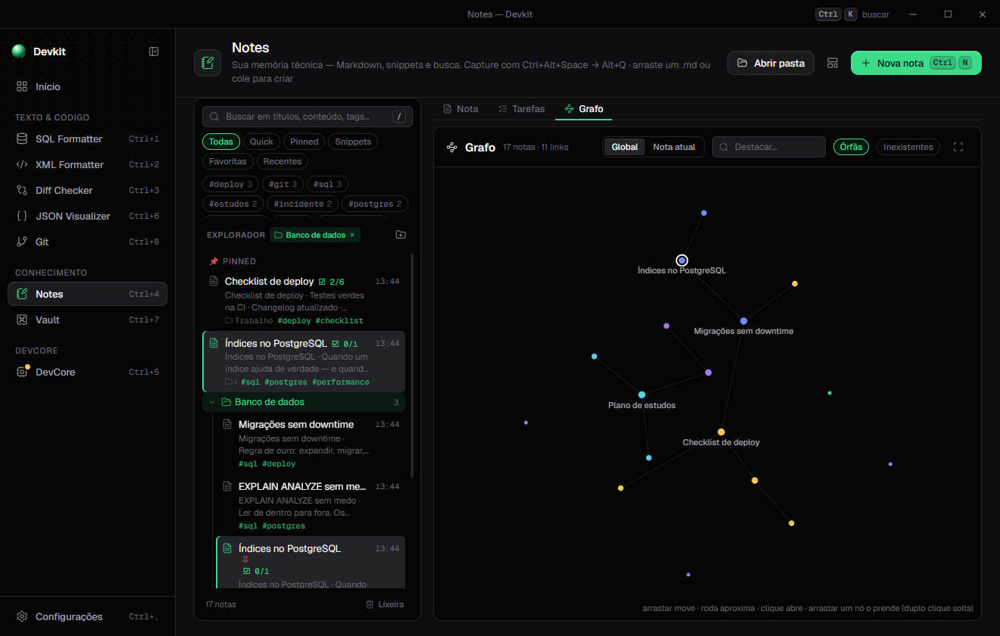

# Toni Devkit — guia das ferramentas

Documentação detalhada de cada ferramenta. Para a visão geral, veja o [README](../README.md).

## Objetivo

O Toni Devkit é uma caixa de ferramentas offline para o dia a dia de desenvolvimento — cada ferramenta roda
localmente, sem depender de sites externos.

## Instalação

Requisitos: **Node 20+**.

```bash
git clone https://github.com/tonissx/toni-devkit.git
cd toni-devkit
npm install
npm start          # compila o renderer e abre o app
```

Outros comandos úteis:

```bash
npm run dev        # como o start, mas com DevTools abertas
npm test           # todos os testes no Node (motores, serviços, palette, DevCore; sem Electron)
npm run dist       # gera instalador Windows (NSIS) + portable em dist/
npm run dist:mac   # gera .dmg (macOS)
npm run dist:linux # gera AppImage (Linux)
```

## Ferramentas

| Ferramenta | Status |
| --- | --- |
| **SQL Formatter**: formata no mesmo padrão do sqlformat.org | ✅ |
| **XML Formatter**: formata nos moldes do vscode-xml (LemMinX) | ✅ |
| **Diff Checker**: compara dois textos nos moldes do diffchecker.com | ✅ |
| **JSON Visualizer**: edita, formata e explora JSON como grafo (estilo JSON Crack), árvore, YAML ou CSV | ✅ |
| **Git**: repositórios locais com grafo do histórico, stage por trecho, merge com prévia, conflitos, rebase visual, blame, bisect e desfazer qualquer coisa | ✅ |
| **Logs**: logs grandes (Fluig/JBoss, JSON por linha, IIS, Nginx/Apache, texto) com filtros, erros agrupados, gráficos e acompanhamento ao vivo | ✅ |
| **Banco**: monitor de SQL Server — bloqueios, sessões, queries caras, deadlocks e saúde, ao vivo e com histórico | ✅ |
| **SQL Visualizer**: SQL como grafo — diagrama ER, explorador de schemas grandes, lineage de query e plano de execução | ✅ |
| **Notes**: memória técnica em Markdown, snippets e busca, integrada à palette | ✅ |
| **Diagramas**: quadro de desenho livre (Excalidraw) para ER, fluxos e esquemas, salvo junto das Notas, com exportação PNG/SVG | ✅ |
| **Vault**: cofre de senhas, tokens e credenciais de banco, com senha mestra e cópia que se apaga | ✅ |
| **DevCore**: infraestrutura idle com DevPets, descobertas pelo uso do DevKit | ✅ |

### SQL Formatter

O formatador usa **o mesmo motor do sqlformat.org**: o módulo Python [`sqlparse`](https://github.com/andialbrecht/sqlparse)
rodando em [Pyodide](https://pyodide.org) (CPython em WebAssembly), que é justamente o que o sqlformat.org usa hoje.
Por isso a saída é idêntica à do site. Roda 100% offline, num *worker thread* do processo principal.

Opções (persistidas localmente):

- **Palavras-chave**: UPPER · lower · Capitalize · Manter (padrão: UPPER)
- **Identificadores**: UPPER · lower · Capitalize · Manter (padrão: Manter)
- **Indentação**: 1, 2, 3, 4 ou 8 espaços, ou Tab (padrão: 2 espaços)
- **Remover comentários**, **Compacto**, **Saída** em SQL / Python / PHP (as mesmas opções do site)
- **Formatar ao digitar** (debounce), ou manual com `Ctrl+Enter`
- Botão **Padrão sqlformat.org** restaura os padrões do site

Atalhos: `Ctrl+Enter` formatar · `Ctrl+Shift+C` copiar saída · `Ctrl+O` abrir .sql · `Ctrl+S` salvar saída ·
`Ctrl+K` command palette · `Ctrl+\` recolher sidebar · `Ctrl+,` configurações.

### XML Formatter

Formatador de XML próprio, em JS puro (sem dependências, roda direto no renderer). As opções seguem os moldes
do **[LemMinX](https://github.com/eclipse-lemminx/lemminx)** — o motor de formatação Java por trás da extensão
[vscode-xml](https://github.com/redhat-developer/vscode-xml) — mas a formatação em si é reimplementada em JS
(o LemMinX é um language server Java, inviável de embutir num app Electron offline). Valida apenas boa-formação
(tags fechadas, aspas terminadas etc.), não contra XSD/DTD.

Opções (persistidas localmente, padrões = padrões do LemMinX):

- **Indentação**: 1, 2, 3, 4 ou 8 espaços, ou Tab (padrão: 4 espaços)
- **Largura máx.**: 80 / 100 / 120 colunas ou sem limite — atributos que estourarem quebram em várias linhas
- **Elementos vazios**: Manter · `<a/>` · `<a></a>` (padrão: Manter)
- **Aspas**: Manter · `"` · `'` (padrão: Manter)
- **Dividir atributos** (um por linha sempre), **Fechamento em nova linha**, **Espaço antes de `/>`**,
  **Juntar linhas de texto/comentário/CDATA**, **Formatar ao digitar**
- Elementos com `xml:space="preserve"` e conteúdo misto (texto + tags juntos) não são reindentados por dentro
- Botão **Padrão VS Code XML** restaura os padrões do LemMinX

Atalhos: `Ctrl+Enter` formatar · `Ctrl+Shift+C` copiar saída · `Ctrl+O` abrir .xml · `Ctrl+S` salvar saída.

### Diff Checker

Comparador de textos inspirado no [diffchecker.com](https://www.diffchecker.com/pt/). Motor próprio em JS puro
(algoritmo de Myers O(ND) em espaço linear, sem dependências), roda direto no renderer.

- **Visualização**: Lado a lado (com scroll sincronizado) ou Unificado (estilo git)
- **Destaque dentro da linha**: Inteligente (caractere para mudanças pequenas, palavra para as maiores) · Palavra · Caractere
- **Sintaxe**: automática (pela extensão do arquivo ou pelo conteúdo) ou JSON / JavaScript / SQL / XML / Texto
- **Ignorar espaços**, **Ignorar maiúsculas**, **Recolher iguais** (mantém 3 linhas de contexto), **Comparar ao digitar**
- **Mesclar**: os botões `→` / `←` entre os lados aplicam um bloco de mudança no outro texto
- Abrir arquivo em cada lado pelo diálogo ou arrastando o arquivo para o editor (até 20 MB)
- **Recolher editores** deixa a tela toda para o resultado

Atalhos: `Ctrl+Enter` comparar · `Alt+↓` / `Alt+↑` próxima/anterior mudança · `Ctrl+O` abrir no Original ·
`Ctrl+Shift+O` abrir no Alterado · `Ctrl+Shift+S` trocar lados.

### JSON Visualizer

Editor de JSON com visualização no estilo do [JSON Crack](https://jsoncrack.com/): editor à esquerda e, à direita,
o documento como **grafo de nós** (esquerda → direita). Tudo em JS puro e sem dependências (validador, layout em
árvore e renderização SVG próprios), 100% local.

- **Grafo**: um nó por objeto/array, com as chaves primitivas como linhas (coloridas por tipo) e as arestas rotuladas
  pela chave/índice. Arraste para mover, roda do mouse para zoom, **Enquadrar**, **Expandir/Recolher tudo** e o botão
  `+`/`−` de cada nó. Clicar num nó destaca o caminho até a raiz e mostra o JSONPath, com botões para copiar o
  **caminho** ou o **valor**. Documentos com mais de 2500 nós abrem recolhidos a partir da profundidade 3.
- **Árvore**, **YAML** e **CSV**: outras visões do mesmo documento (no CSV, um array na raiz gera uma linha por item e
  um objeto gera uma linha única; objetos aninhados viram colunas `a.b` e arrays viram `a[0]`).
- **Buscar / JSONPath**: texto livre destaca os nós que contêm a chave ou o valor; uma expressão começando com `$`
  é avaliada como JSONPath (`$`, `.chave`, `['chave']`, `[n]`, `[*]`, `.*`, `..chave`).
- **Formatar** (indentação 2, 4 ou Tab, com **Ordenar chaves**) e **Minificar**.
- **Erros de sintaxe** apontam linha e coluna no editor; o grafo mantém o último JSON válido enquanto você corrige.
- **Exportar** o grafo como **PNG** ou **SVG** (segue o tema atual); **Abrir**/**Salvar** arquivos `.json` (até 20 MB).

Atalhos: `Ctrl+Enter` formatar · `Ctrl+Shift+C` copiar a visão atual · `Ctrl+O` abrir .json · `Ctrl+S` salvar a visão atual.

### Git

Uma interface visual para os repositórios do computador, pensada para quem usa o básico do git e trava nas
operações do meio para cima. Usa o **git instalado** (sem shell, sem rede: nada de fetch/pull/push por enquanto).

- **Repositórios**: **Adicionar pasta** (se a pasta não for um repositório, procura os que estão dentro dela) ou **Procurar
  no PC** (Documentos, `source\repos`, pasta do usuário). Cada um mostra a branch e as mudanças pendentes; abre no
  Explorer, no VS Code ou num terminal. A lista fica em `%APPDATA%\Toni Devkit\git-repos.json`
- **Visão geral**: números, mapa de atividade dos últimos 90 dias, quem mais commitou, arquivos mais alterados, último commit
- **Mudanças**: preparadas, modificadas, novas e em conflito; o diff mostra o que mudou dentro da linha e cada **trecho**
  tem **Preparar** / **Tirar do stage** / **Descartar** (o `git add -p` sem decorar nada). Caixa de commit com contador da
  1ª linha, `Ctrl+Enter` e **corrigir o último commit** (amend)
- **Histórico**: **grafo** dos commits com raias nas cores do tema, branches e tags, filtros por mensagem e autor; o
  commit escolhido mostra mensagem, arquivos e diff, e permite **criar uma branch ali** ou **voltar a branch para lá**
  (mantendo as mudanças no stage, nos arquivos, ou jogando fora). A bandeja de detalhes é **expansível**: arraste a borda
  esquerda (ou use ← / →) para dar mais espaço ao diff; duplo clique alterna entre a largura padrão e a ampla
- **Branches**: à frente/atrás da base (main), **mesclada**, upstream; criar, **trocar** (com mudanças pendentes pergunta:
  guardar num stash ou levar junto), renomear, excluir e **comparar duas branches** (o que cada uma tem, o ancestral comum,
  os arquivos e o diff)
- **Stash**: guardar com nome (inclusive arquivos novos), ver o conteúdo, aplicar, aplicar e remover, descartar
- **Máquina do tempo**: os pontos de volta do Devkit e o **reflog** em português ("Trocou de main para feature", "Corrigiu o
  último commit"…), com **recuperar como branch** e **voltar para cá**
- **Aprender**: passar o mouse em qualquer ação mostra o **comando git equivalente**; operações que reescrevem o histórico
  ou descartam trabalho pedem confirmação com a explicação, o comando e o **nível de risco**; depois de executar, a barra
  de baixo mostra o comando que rodou, "O que isso fez?" e **Desfazer**
- **Nada se perde**: antes de descartar, corrigir commit, voltar a branch, excluir branch ou stash, o Devkit grava um
  ponto de volta em `refs/devkit/backup/…` (as mudanças via `git stash create`) e cópias de arquivos novos apagados em
  `.git\devkit\` — os 30 mais recentes. O próprio Desfazer também vira um ponto de volta

**Operações guiadas (fase 2)**

- **Mesclar com prévia** (Branches → ícone de merge na linha, ou "Atualizar minha branch com a main"): antes de mexer em
  qualquer coisa mostra os commits que entram, se dá para só avançar (fast-forward) e **quais arquivos vão conflitar**
  (`git merge-tree`). Automático ou sempre com commit de merge
- **Conflitos**: merge, cherry-pick e rebase que param em conflito não são erro — a tela vai para Mudanças e cada arquivo
  em conflito abre o **editor**: a sua versão e a deles lado a lado (e como era antes, quando o git sabe), com **Meu /
  Deles / Os dois / Os dois (deles primeiro) / Editar** por bloco, "todos os blocos" de um lado, ou o arquivo inteiro de um
  lado; conflitos de exclusão e binários têm as opções próprias. **Marcar como resolvido** só libera sem marcadores.
  A faixa do topo mostra **Continuar** e **Cancelar o merge/rebase/cherry-pick**. No rebase os rótulos se invertem
  ("base" e "seu commit"), como o git
- **Cherry-pick**: no Histórico, um commit que não está na branch atual tem **Trazer para a branch atual**
- **Reorganizar (rebase interativo visual)**: os últimos N commits, do mais antigo ao mais novo; arraste (ou ↑/↓) para
  reordenar e escolha **Manter / Mudar mensagem / Juntar ao de cima / Juntar sem a mensagem / Remover**. A prévia mostra
  como a branch vai ficar; avisa quando mexe em commits já enviados e recusa intervalos com merges. Roda o `git rebase -i
  --autostash` com o plano gravado pelo Devkit (sem abrir editor)
- **Quero…**: receitas em linguagem comum — desfazer o último commit, mudar a mensagem, **commitei na branch errada** (move
  os últimos commits para uma branch nova), **juntar meus últimos commits**, reorganizar, trazer um commit ou **um arquivo
  de outra branch**, atualizar com a main, mesclar, descartar tudo, guardar para trocar de assunto, commitar só parte,
  comparar branches, recuperar algo, resolver conflitos. Cada uma leva à aba, ao assistente ou à operação certa. Também na
  palette: `Ctrl+Alt+Space` → "git juntar", "git branch errada"…

**Investigar, manter e integrar (fase 3)**

- **Investigar**:
  - **Quem mudou cada linha** (blame): o arquivo em blocos coloridos por commit, com mensagem, autor e data; clicar abre o
    commit no Histórico
  - **Quando um texto apareceu**: commits em que o texto apareceu ou sumiu (`git log -S`) — "quem removeu aquela
    validação?" — ou que casam uma expressão regular (`-G`), com os arquivos de cada um
  - **Histórico de um arquivo**: todas as versões (segue renomeações), com o diff de cada uma
  - **Achar o commit de um bug** (bisect guiado): escolha uma versão que funcionava; o Devkit leva o repositório a commits
    no meio do caminho e você responde **Funciona / Está quebrado / Pular** até ele apontar o culpado. A faixa do topo
    lembra que há uma caça em andamento; **Encerrar** volta para a branch
- **Manutenção**: **tags** (criar simples ou anotada no commit atual, excluir com ponto de volta) · **branches já
  mescladas** (marcadas, exclui de uma vez, recuperáveis; as abertas num worktree aparecem bloqueadas) · **worktrees**
  (as pastas extras do repositório, como as de `.claude/worktrees`; remover libera a branch) · **arquivos e pastas não versionados** (o que um
  `git clean` apagaria, com escolha e cópia antes) · **.gitignore** (ver e acrescentar padrões). Em Mudanças, o ícone de
  olho riscado num arquivo novo sugere padrões (este arquivo, a extensão, a pasta…) — inclusive para pastas com outro
  repositório dentro
- **Ritmo** na Visão geral: dias da semana × horas dos commits dos últimos 180 dias
- **Integrações**: no detalhe do commit, **salvar como nota** (mensagem, arquivos e diff numa nota com tag `git`) e, por
  arquivo, **abrir no Diff Checker** (antes × depois). A palette lista cada repositório ("Git: <nome>") e as receitas; o
  uso conta no DevCore

**IA**: mensagem de commit, explicar commit, combinar conflito, nome de branch e resumo de PR — ver [IA (opcional)](#ia-opcional)

### Logs

Para achar rápido o que deu errado num log. Abre arquivos de centenas de MB em segundos, acompanha o arquivo
**ao vivo** (como o `tail -f`) e junta pastas de **logs rotacionados**. Tudo é lido nesta máquina; nada sai do PC.

- **Abrir**: arquivo, pasta ou **arrastar e soltar** — também por caminho de rede (`\\servidor\fluig\logs`), desde que o
  Windows já tenha acesso ao compartilhamento. Na pasta, os rotacionados de uma "família" viram um log só, do mais
  antigo ao atual — `server.log` + `server.log.2026-10-10`, `app.log` + `app.log.1` + `app.log.2.gz`, `app.2026-10-10.log`,
  `u_ex261011.log` (IIS) — e dá para trocar de família no cabeçalho. Recentes na tela inicial e na palette
- **Formatos** (detectados sozinhos, ou escolhidos no cabeçalho — fica lembrado): **Fluig / JBoss / WildFly** (`server.log`,
  inclusive o console que grava só a hora), **JSON por linha** (pino, winston, serilog, bunyan…), **IIS (W3C)** pelo
  `#Fields:`, **Nginx/Apache** (combined, com `$request_time`), **texto com data** (log4j, logback, Spring, syslog,
  Python) e **texto simples**. Stack traces e mensagens de várias linhas viram **uma entrada só**. Encoding: UTF-8,
  UTF-16 e **Windows-1252** (comum no Fluig no Windows), também escolhível
- **Filtros**: chips de nível com contagem (Ctrl+clique = só este; **Problemas** = avisos e erros) e uma busca com
  regras simples, todas precisando casar: `timeout`, `"frase exata"`, `/regex/i`, `-esconder`, `level:error+`,
  `logger:fluig`, `thread:task-12`, `status:5xx`, `ms:>500`, `path:/api/*`, `user.id:42` (campos do JSON ou
  `chave=valor`), `has:stack`, `exception:NullPointer`. **Filtros salvos** com nome. `Ctrl+F` foca a busca. Com o
  campo vazio, ele lista os **últimos filtros usados** (↑↓ + Enter, ou clique)
- **Filtrar não esconde o log**: a lista continua com o log inteiro e os **achados vêm marcados**; um painel embaixo
  (**Achados**) lista só os que casaram — clicar leva a lista até a entrada, e `n`/`N` (ou ▲▼) pulam de achado em achado.
  Uma **faixa de marcadores** ao lado da rolagem mostra onde eles estão (cor do pior nível; clique/arraste para ir até lá).
  **± contexto** (0/2/5/10) realça as entradas vizinhas de cada achado, como o `grep -C`; **Só filtrados** volta a mostrar
  na lista apenas o resultado (com o contexto, se pedido). O painel de baixo e o **Detalhe** (lado direito) têm a borda
  **arrastável** para ajustar o tamanho (duplo clique alterna padrão/ampliado; setas ajustam; arrastar o painel de baixo até
  o fim deixa só o cabeçalho) — o tamanho fica lembrado
- **Fixar**: `m` (ou o alfinete no detalhe) fixa a entrada selecionada — ela ganha um alfinete na lista e entra na aba
  **Fixados** do painel de baixo, para voltar a ela depois. Valem só enquanto o log está aberto
- **Investigação** (aba própria): `i` (ou **Investigar** no detalhe) guarda a entrada selecionada num **caso**; a aba mostra o
  **passo a passo** — hora, o **intervalo desde o passo anterior** (+3,2 s), nível, etiqueta (**Suspeita / Causa / Efeito /
  Ruído**), anotação e "mesma falha ×N" quando o grupo se repete. Ordem **cronológica** ou **de coleta** (reordenável),
  **± contexto** (traz as vizinhas de um passo), **Ir ao log**, **O que o banco fazia?** nos passos de banco, **hipótese** e
  **conclusão**. Exporta para Markdown (com ou sem segredos) ou para o **Notes**. A **IA** lê o caso inteiro: linha do tempo,
  causa provável (citando os passos), correlações, o que falta provar, próximos passos e **filtros prontos** para aplicar no
  log; dá para **perguntar** algo sobre o caso. Os casos ficam salvos (com cópia do texto) mesmo se o log rotacionar
- **Seguir**: no detalhe, o filtro ao lado de cada campo (thread, ip, caminho, status, ids de correlação do JSON…) e
  o botão **Thread** filtram por aquele valor exato, trocando o filtro anterior da mesma chave
- **Linha do tempo**: colunas empilhadas por nível (os erros na base), com os **picos de erro** marcados. Passar o mouse
  mostra o horário e a contagem de cada nível **no cabeçalho do gráfico** (nada cobre as barras); **arrastar** escolhe um
  intervalo, mostrando antes de soltar quantas entradas e erros ele tem (vira filtro); **clicar** leva a lista até aquele
  momento. Pelo teclado: `←`/`→` andam entre as colunas, `Shift` + setas seleciona, `Enter` aplica. O modo **Problemas**
  mostra só avisos e erros com escala própria, e a linha do tempo pode ser **recolhida** para dar espaço às linhas
- **Linhas**: lista virtualizada (milhões de linhas sem travar), cor e ícone por nível, termos buscados em destaque e
  "+N" nas entradas com stack. `↑↓` andam, **`n`/`N`** pulam para o próximo/anterior erro, `w` para o próximo aviso,
  `End` vai ao fim. Ao vivo, se a lista está no fim ela acompanha; se você subiu para ler, ela para e mostra **↓ N novas**.
  **Selecionar um texto** destaca as ocorrências iguais nas outras linhas visíveis (sem custo: só as linhas da tela), com
  a contagem e **Filtrar** (o log inteiro) no rodapé
- **Detalhe**: mensagem, campos (logger, thread, requisição, status, tempo, JSON), **stack** com os frames do framework
  (Java, JBoss, Hibernate…) apagados e recolhidos e o `Caused by` em destaque, **contexto** (±50 entradas sem filtro) e o
  texto original. **Copiar**, **Copiar sem segredos** (senhas, tokens, `Authorization`, e-mails e CPFs viram `‹oculto›`)
  e **Notes** (cria uma nota com a entrada)
- **Problemas**: erros e avisos **agrupados** — a mesma falha com ids, números e horários diferentes vira uma linha só
  (pela exceção, a causa raiz, o primeiro frame do sistema e a mensagem sem as partes que variam). Cada grupo mostra
  quantas vezes (no filtro e no total), desde quando, a última vez, o desenho no tempo e **novo** (apareceu depois que o
  log foi aberto ou só na última hora). **Só este problema** / **Esconder** viram filtro (`group:…`)
- **Gráficos** (respeitam o filtro): erros por minuto, níveis e loggers mais frequentes; nos logs de acesso, **respostas
  por classe** (2xx–5xx) no tempo, **tempo de resposta p50/p95**, e os endpoints mais chamados, com mais 5xx e mais
  lentos (ids no caminho viram `:id`). Clicar filtra. Ao vivo, recalculam no máximo a cada 3 s
- **Exportar** o que está filtrado em `.log` ou `.md`, ou copiar até 200 entradas
- **Desempenho**: o texto fica num worker thread do processo principal e a tela só pede as linhas visíveis. O índice
  guarda cada entrada em arrays compactos; a busca de texto roda direto sobre blocos de MB. Num PC comum: 500 MB (4,2
  milhões de entradas) indexados em ~6 s, filtros de nível e texto em 40–260 ms (`npm run logs:bench`). Acima de
  1,5 GB, abre só o final e avisa
- **Ao vivo**: `fs.watch` + conferência de tamanho a cada 1 s (no Windows — e em compartilhamentos de rede — o watch perde
  gravações). Cresceu → lê só o que chegou; zerado ou rotacionado (outro arquivo no mesmo nome) → reabre e avisa. O
  arquivo não fica aberto entre as leituras, então não atrapalha a rotação do servidor
- **Início**: painel **Logs** com os abertos e os **erros novos** desde a última vez que você olhou

Recentes, filtros salvos e formato escolhido à mão ficam em `%APPDATA%\Toni Devkit\logs.json`. Testes: `npm run test:logs`.

**IA**: explicar o erro e resumir os problemas — ver [IA (opcional)](#ia-opcional)

### Banco

Monitor de SQL Server (2016 ou mais novo) para acompanhar ao vivo e investigar depois. Pensado para DBA de
ambiente Fluig/RM: o que mais custa achar no SSMS — **quem está segurando quem** — aparece em destaque.

- **Servidores**: **Adicionar servidor** com a credencial de uma entrada do **Vault** (login SQL; a senha nunca fica na
  configuração do servidor nem chega à tela). Dá para colar uma connection string ADO.NET ou JDBC: os campos se preenchem
  e, se ela trouxer usuário e senha, **Guardar no Vault** cria a entrada. **Testar conexão** mostra versão, edição e se o
  login tem `VIEW SERVER STATE` (sem ela, só as próprias sessões aparecem). Instância nomeada usa o SQL Browser ou a porta
  informada. Os servidores ficam em `%APPDATA%\Toni Devkit\db-servers.json`
- **Leve para produção**: uma conexão por servidor (`Toni Devkit Monitor`, fora das listas), só views de sistema, leitura
  suja (`READ UNCOMMITTED`), `LOCK_TIMEOUT` de 1 s e prioridade baixa em deadlock — se algo der errado, o monitor é a
  vítima. Plano de execução nunca no ciclo, só sob demanda. Ciclo de 5 s com a tela aberta (2–30 s, ajustável) e de 15 s
  em segundo plano; esperas a cada 15 s, CPU e deadlocks a cada minuto. Medido num SQL Server Express: ~4 ms de CPU e ~130
  leituras lógicas por ciclo
- **Agora**: CPU do SQL, lotes/s, conexões, sessões ativas, bloqueadas e page life expectancy, com o desenho dos últimos
  minutos. A **árvore de bloqueio** mostra a cabeça no topo (inclusive **ociosa com transação aberta** — o `BEGIN TRAN`
  esquecido) e quem espera, há quanto tempo e em quê. Sessões ativas ordenáveis e filtráveis (programa, login, banco,
  espera, texto), esperas do momento por categoria (lock, disco, log, CPU, rede…) com o que cada uma costuma significar.
  O detalhe da sessão traz o SQL (comando ou lote inteiro), espera, recurso, transações, isolamento, **Plano** (abre o
  visualizador do plano), **SQL Formatter** e **Encerrar**
- **Encerrar (KILL)**: só com confirmação, que mostra login, programa, computador, banco, quantas sessões ela segura e há
  quanto tempo a transação está aberta (e avisa que desfazer uma transação antiga pode demorar). Antes de encerrar, o
  Devkit confere se a sessão ainda é a mesma — o número é reaproveitado pelo SQL Server — e registra no histórico
- **Histórico**: com **Monitorar em segundo plano**, o Devkit grava enquanto estiver aberto (inclusive na bandeja), em
  `%APPDATA%\Toni Devkit\db-monitor\<servidor>\AAAA-MM-DD.ndjson`, por 7 dias. As séries (bloqueadas, sessões ativas, CPU,
  lotes/s, esperas de lock, PLE) ficam uma embaixo da outra, cada uma com a sua escala; os **incidentes** aparecem como
  marcadores — **bloqueio** acima de 10 s, **query** acima de 30 s, **deadlock**, **sessão encerrada** e **queda da
  conexão**. Arrastar aproxima; clicar mostra o **retrato** daquele momento; cada incidente guarda a árvore e o SQL de
  quem estava envolvido (e vai para o **Notes** num clique)
- **Queries**: as mais caras por CPU, duração, leituras ou execuções (totais e médias), do cache de planos (agrupadas por
  `query_hash` — a mesma query com parâmetros diferentes) ou do **Query Store** de um banco, com período. Riscos comuns
  do texto (como no SQL Formatter), plano sob demanda
- **Plano de execução** (botão **Plano** em Queries e no detalhe da sessão): visualizador dentro do Devkit. Desenho do plano
  da instrução às tabelas, com % do custo por operador, espessura da seta pelo volume de linhas e selo nos operadores com
  problema; tabela de operadores ordenável; XML; **Salvar .sqlplan** para o SSMS. Os **insights** apontam scans caros,
  Key Lookups, derrame para o tempdb, conversão implícita (e se ela impede o Seek), estimado × real (plano real), índice
  sugerido com o `CREATE INDEX` pronto, memory grant exagerado ou em fila, plano serial, otimizador que desistiu,
  parameter sniffing e estatísticas desatualizadas — cada um diz o que viu, por que importa e o que fazer
  **Explicar o plano** (IA): manda só um resumo do plano — números, achados e operadores mais caros, com segredos
  removidos — e devolve o que está caro, por quê e o que fazer em ordem de ganho
- **Deadlocks**: lidos do `system_health` do próprio SQL Server a cada minuto (só os novos). Cada um vira um **desenho** —
  processos em cima, recursos embaixo, seta tracejada = espera, contínua = segura, **vítima** com ícone — e um cartão por
  processo com programa, login, o lock que pedia, isolamento, procedure/linha e o SQL. **Copiar XML**, **Salvar .xdl**
  (o SSMS abre como desenho) e **Notes**
- **Saúde**: o que pede atenção (log acima de 80% **com o motivo** — `LOG_BACKUP`, `ACTIVE_TRANSACTION`…, disco com pouco
  espaço, banco sem backup completo ou em FULL sem backup de log, job do Agent que falhou, PLE baixo, queries esperando
  memória), uso do log por banco, discos, backups, **conexões por programa** (com quantas têm transação aberta) e
  **índices sugeridos** pelo otimizador — só sugestão: o `CREATE INDEX` é para copiar e revisar, nunca aplicado
- **Integrações**: no detalhe de um erro dos **Logs** que fala de banco (timeout, SQLException, deadlock…), **O que o banco
  fazia?** abre o histórico naquele horário. Palette: "Banco: quem está bloqueando?" e um comando por servidor. Início:
  painel com os servidores e os bloqueios do momento
- Datas na hora certa mesmo com o servidor em outro fuso (o monitor lê o fuso do servidor ao conectar)

Testes: `npm run test:db`. **IA**: por que a query está lenta e explicar o deadlock — ver [IA (opcional)](#ia-opcional)

### SQL Visualizer

Transforma SQL em grafos interativos, inspirado em JSON Crack, ChartDB, Azimutt, SQLFlow e Paste The Plan. **O SQL colado
nunca é executado**: só é lido. Tudo é processado no próprio app; o único acesso ao servidor é o opcional "Carregar", que lê
o **catálogo** (tabelas, colunas e chaves, via `sys.*`), nunca dados de tabela. Nomes de tabela e coluna entram na tela como
texto (React/SVG), nunca como HTML. As abas ficam montadas, então o que foi colado ou carregado sobrevive à troca de aba.

**Diagrama ER**
- Entrada: **DDL** (`CREATE TABLE`, `ALTER TABLE … FOREIGN KEY`, PK simples ou composta) ou o **JSON de metadados**. O botão
  *Query de metadados* copia a query T-SQL que gera esse JSON (uma célula só) para rodar no banco. Ou **Carregar do servidor**:
  escolhe um servidor salvo na aba Banco e um banco (a senha vem do Vault no processo principal; a query roda por
  `sp_executesql` no banco escolhido, sem trocar o banco da conexão do monitor)
- Tabelas com colunas, tipo e marcas PK/FK; relacionamentos com cardinalidade 1:N (ou 1:1). Cada FK liga **a coluna
  filha à coluna referenciada** e tem uma cor própria: aresta, pontas e faixas das colunas usam a mesma cor. Ao selecionar
  uma tabela, as ligações mostram `colunaFK → colunaPK`
- Zoom e pan, arrastar tabelas, layout hierárquico automático, **busca** de tabela ou coluna com destaque e centralização
  (Enter vai para a próxima), clique numa tabela destaca só as relacionadas
- Teclado: Tab entre tabelas, setas para a vizinha mais próxima, Enter/Espaço seleciona, Esc limpa
- Exporta **PNG**, **SVG** e **DBML**

**Explorador** (schemas grandes)
- O canvas **começa vazio**: busque uma tabela (por nome ou coluna), filtre por schema e prefixo e clique para adicioná-la.
  A lista é virtualizada (testada com 5.000 tabelas) e só as tabelas adicionadas são desenhadas
- **Expandir vizinhas** por FK, 1 ou 2 níveis, a partir da tabela selecionada ou de todas; *Adicionar todas* as filtradas.
  As duas ações têm teto de 150 tabelas por vez
- **Agrupar por módulo** (por schema, por prefixo antes do `_` ou pelas primeiras letras), com uma caixa colorida por
  módulo e reorganização por grupo
- **Layouts nomeados**: salvar, carregar e apagar, por servidor e banco (no `localStorage`). Tabelas que não existem mais
  são ignoradas, com aviso

**Lineage** (estilo SQLFlow)
- Cole um `SELECT`, CTE (inclusive recursiva), `UNION`, subconsultas, `CROSS`/`OUTER APPLY`, `INSERT … SELECT` ou um script
  (`GO` separa lotes; `SELECT … INTO #temp` é reaproveitada nas instruções seguintes)
- Grafo: tabelas de origem → CTEs e subconsultas → colunas do resultado. Os **JOINs** são rotulados com tipo e condição;
  **filtros** (`WHERE`/`HAVING`) e **agregações** ganham destaque; as colunas das tabelas levam marcas J (join), F (filtro),
  G (group by), O (order by), Σ (agregação) e ƒ (expressão)
- **Clique numa coluna de saída** para destacar de quais colunas de origem ela deriva (e esmaecer o resto)
- Se um schema estiver carregado no Explorador, *usar schema* resolve `SELECT *` e colunas sem alias com precisão; sem ele,
  essas colunas ficam marcadas como ambíguas, com aviso
- **Parser**: [`node-sql-parser`](https://github.com/taozhi8833998/node-sql-parser) no dialeto `transactsql`, empacotado
  no app (Apache-2.0; ver `THIRD-PARTY-NOTICES.md`). Escolhido por rodar no cliente e dar AST de CTE/JOIN/subconsulta; o
  `sqlglot` exigiria um backend Python. Antes de ler, o app ajusta o que o parser não entende: remove `OPTION (…)`,
  `WITHIN GROUP (…)`, `AT TIME ZONE` e `WITH TIES`, lê `TRY_CAST` como `CAST` e `EXCEPT`/`INTERSECT` como `UNION` (a
  linhagem é a mesma) e avisa o que mudou. Texto dentro de strings e `[identificadores]` não é tocado
- **Limitações do dialeto**: `MERGE` dá erro claro; `UPDATE`, `DELETE`, procedures e SQL dinâmico são ignorados com aviso;
  `PIVOT`/`UNPIVOT` e funções com valor de tabela aparecem como uma caixa só, sem as colunas internas; sem o schema,
  `SELECT *` sobre tabela não é expandido. O botão *Limitações* na própria aba lista tudo

**Plano de execução**
- Cole o XML do showplan ou **abra/arraste um `.sqlplan`** (UTF-16 do SSMS, UTF-16 sem BOM e UTF-8 são lidos). Usa o
  mesmo visualizador do plano da aba Banco: grafo de operadores com custo relativo (%), linhas estimadas × reais, espessura
  da seta proporcional às linhas, operadores, XML e instruções múltiplas
- **Gargalos** com explicação e o que fazer: operador mais caro, scan em tabela grande, Key Lookup, Sort/Hash com spill
  para o tempdb, estimativa muito diferente do real, conversão implícita, memory grant, parameter sniffing e **índices
  sugeridos** (`MissingIndexes`, com o `CREATE INDEX` para copiar e revisar — nunca aplicado)
- Painel lateral com as propriedades do operador selecionado e o resumo dos avisos

Testes: `node --test scripts/test-sqlviz-*.mjs` (DDL, metadados, layout, DBML, explorador, lineage com consultas reais, plano com
`.sqlplan`). **Limitações gerais**: o canvas do Explorador não é salvo sozinho (use *Salvar* num layout); o schema carregado do
servidor não persiste entre sessões; o Lineage não exporta imagem; a aba Plano mostra um plano por vez.

## IA (opcional)

Desligada por padrão: com ela desligada nenhum botão de IA aparece. Ligada, cada ferramenta ganha botões ✦ que fazem um
pedido só quando clicados. Em todos: **Ver o que é enviado** mostra o pedido exato, a resposta aparece aos poucos,
`Esc`/**Parar** interrompe, e nada é aplicado sem clique (quase tudo tem **Desfazer**). **O Vault nunca entra em
pedido nenhum** — notas vão com as referências dos blocos `secret`, nunca com o segredo.
Toda resposta em texto traz **Copiar resposta** e **Gerar prompt de melhoria**: o segundo copia um prompt pronto (o pedido
que já saiu filtrado, a resposta e o passo a passo para aplicar com senso crítico) para colar no Claude Code, Copilot ou
ChatGPT — montado localmente, sem outra chamada à IA.

| Onde | O quê |
| --- | --- |
| Git → Mudanças | **Sugerir** a mensagem de commit (diff preparado + estilo dos últimos commits), escrita direto na caixa |
| Git → Histórico | **Explicar este commit** (o que mudou, por quê, o que observar) e salvar como nota com a explicação |
| Git → conflitos | **Sugerir combinação** por bloco; **Usar esta versão** cai no Editar para revisar antes de resolver |
| Git → Branches | **Nova branch**: descreva a tarefa e escolha um dos 3 nomes (com o prefixo que o repositório usa) · **Comparar**: **Resumo para PR** (título + descrição para copiar) |
| SQL Formatter | **Explicar consulta** · **Escrever ou alterar com IA**: *Nova consulta* a partir de uma descrição, ou *Alterar a atual* (“trocar o LEFT JOIN por INNER”, “só 2025”…) — muda só o que foi pedido, com **Comparar no Diff Checker** e **Desfazer**; o esquema das tabelas é opcional e fica lembrado no PC |
| JSON Visualizer | **Melhorar nomes** dos tipos gerados (só os nomes mudam; o Devkit aplica no código original) · **Explicar o erro** quando o Consertar não resolve |
| Diff Checker | **Resumir diferenças** (adicionado, removido, alterado e o que parece arriscado) |
| Banco | **Por que está lenta** (sessão ou query do top: o que faz, por que pode estar lenta pelas métricas e pela espera, o que conferir e sugestões) · **Explicar** o deadlock (o ciclo, por que acontece, como evitar). O SQL passa antes pelo filtro de segredos |
| Logs | **Explicar** o erro selecionado (o que aconteceu, causa provável, onde olhar, como confirmar — com o contexto do Fluig quando é um log do Fluig) · Problemas → **Resumir** (triagem dos grupos do filtro) · Investigação → **Analisar** o passo a passo guardado (e perguntar sobre ele). O texto passa antes pelo filtro de segredos |
| Notes | Botão **IA** no editor: **título e tags** (em chips, reaproveitando as tags que já existem), **Resumir** (insere no topo), **Transformar em checklist** (seleção ou nota toda) · **Perguntar às notas**: digite a pergunta na busca |
| Palette | Comece com **`?`** para perguntar (pode sugerir ações do Devkit) · em Notes, `?` pergunta às notas · **IA: explicar o que está copiado** (SQL, JSON, XML, código ou erro com stack) |

**Sem IA** (sempre disponíveis): avisos de risco no SQL (UPDATE/DELETE sem WHERE, JOIN sem ON, SELECT *, NOT IN com
subconsulta…), visão **Tipos** no JSON (TypeScript, C# e JSON Schema), **Consertar** JSON (comentários, vírgulas
sobrando, aspas simples, chaves sem aspas, True/None) e o comando da palette **Gerar tipos TypeScript do JSON copiado**.

**Perguntar às notas** busca primeiro, no PC, as notas que combinam com a pergunta e manda só trechos delas (até 6);
a resposta cita as notas como links. Notas com a tag `privado` nunca vão.

**Configurações → IA**:

- **Local (offline)**: usa o [Ollama](https://ollama.com), um programa à parte que roda o modelo nesta máquina, sem
  internet. **Instalar o Ollama** baixa o instalador oficial, **confere a assinatura digital** (só executa se for válida e
  da Ollama Inc.) e instala para o usuário, sem administrador; ele fica na bandeja, inicia com o Windows e é
  desinstalado à parte. Depois é só escolher e **Baixar** um modelo — o sugerido é o `qwen2.5-coder:3b` (~1,9 GB, rápido
  mesmo sem placa de vídeo); o `7b` é mais preciso e mais lento na CPU. Só aceita Ollama em `127.0.0.1`/`localhost`.
  Nas tarefas mais difíceis (conflito, PR, SQL a partir de texto, perguntas às notas) o painel avisa que a Nuvem vai melhor
- **Nuvem (Claude)**: API da Anthropic pelo SDK oficial (Opus 5.5, Sonnet 5.5 ou Haiku 4.5). A **chave fica no Vault**
  (entrada do tipo API/token) e só é lida no processo principal, na hora da chamada — o cofre precisa estar desbloqueado.
  Antes do primeiro envio pergunta (com a opção de não perguntar de novo)
- **Testar** gera uma mensagem para um diff de exemplo e mostra quanto tempo levou nesta máquina

Configuração em `%APPDATA%\Toni Devkit\ai.json`. As tarefas (o que cada uma envia e como lê a resposta) ficam em
`src/ai/tasks.js`; as peças de tela, em `src/ai/ui.jsx`. Testes: `npm run test:ai`.

## Início

O painel do dia, aberto ao clicar em **Início** na sidebar. Tudo se atualiza sozinho quando uma nota, um link ou o cofre
muda.

- **Cabeçalho**: saudação conforme a hora do dia, a data e o resumo do que vence ("1 tarefa vencida · 2 tarefas para hoje")
- **Status**: quantidade de notas, estado do cofre (aberto → clique bloqueia; bloqueado → abre o Vault), aviso quando
  outro app ocupa `Ctrl+Alt+Space` e a atualização disponível/baixada (um clique baixa ou reinicia já na versão nova)
- **Tarefas**: vencidas, de hoje e dos próximos 7 dias, mais as sem prazo que têm prioridade. Marcar grava na nota;
  clicar no texto abre a nota; o campo no topo captura uma tarefa no **Inbox** (`@hoje`/`@amanha` viram a data)
- **Notas**: as **fixadas** em cima (sempre no mesmo lugar) e as **recentes** (editadas e vistas) embaixo; **Nova** abre uma nota em branco; o ícone que aparece ao passar o
  mouse fixa a nota na tela como sticky note
- **Repositórios** (da ferramenta Git): branch e o que está pendente em cada um — conflito/merge em andamento (vermelho),
  mudanças, commits para enviar, stashes —, os que pedem atenção primeiro; clicar abre o Git no repositório e na aba certa.
  A faixa de status avisa "N repositórios com mudanças" ou "em conflito"
- **Links rápidos**: favoritos abrem com um clique; links com `{q}` têm um campo para o valor e os últimos valores usados
- **DevCore**: Compute, tier, missões do dia e o incidente ativo ou previsto (só consulta o DevCore com o painel visível)
- **Ferramentas**: a grade de sempre, com favoritas primeiro
- **Tema** (botão no cabeçalho): lista os temas com uma miniatura das cores de cada um; trocar vale para o app todo
- **Personalizar** esconde ou mostra cada painel (fica salvo)

As regras do painel (agenda, rótulos de prazo, resumo) ficam em `src/home/dashboard.js` (`npm run test:home`).

## Command Palette

O centro de interação do Devkit. **`Ctrl+Alt+Space`** é o único atalho global: abre a palette de qualquer lugar —
com o app minimizado, em segundo plano ou só na bandeja — flutuando sobre o app atual, no monitor do cursor,
sem restaurar a janela principal. Dentro do Devkit, `Ctrl+K` abre a mesma palette.

- **Digitou, buscou**: letras são sempre texto. A tela inicial busca em tudo de uma vez: comandos, notas e
  snippets, o texto dos rascunhos das ferramentas e, no fim, a web com o texto digitado (Google, MDN,
  Stack Overflow, GitHub, npm, TDN)
- **Categorias com Alt**: `Alt+T` **Tools** · `Alt+A` **Actions** · `Alt+N` **Notes** · `Alt+Q` **Quick Note**
  (em qualquer lugar da palette). `Backspace` com o campo vazio volta um nível. Como o atalho global já tem Alt,
  `Ctrl+Alt+Space` e depois `Q` sem soltar o Alt abre direto a Quick Note
- **Tools**: abre qualquer ferramenta. **Actions**: formatar SQL/XML da área de transferência (sem abrir a janela),
  temas, sidebar, configurações, sair
- Busca por nome, keywords/aliases, descrição e categoria, sem acento e sem maiúsculas; comandos recentes sobem
- `↑`/`↓` navegar · `↵` executar · `Esc` fechar. Sem resultados, oferece buscar na web; erros aparecem na própria
  palette sem fechá-la
- **Bandeja**: fechar a janela mantém o Devkit rodando (o atalho continua valendo). Em Configurações:
  **Iniciar com o Windows** (sobe em segundo plano) e o status do atalho (avisa se outro app já usa `Ctrl+Alt+Space`)

### Links rápidos

Uma URL atrás de um alias, com `{q}` onde entra a parte variável — por exemplo `solic` →
`https://tracker.example.com/tickets?id={q}`.

- **Usar**: digite o alias e aperte **Tab** — ele vira um chip (`solic ›`) e o que você digitar depois entra no `{q}`.
  `Enter` abre no navegador · `Ctrl+Enter` copia a URL · `Backspace` com o campo vazio solta o chip. Os últimos valores
  usados em cada link aparecem para reabrir com um Enter (Tab completa o campo com o selecionado)
- **Só de propósito**: digitar nunca é interceptado — "solic" sozinho continua sendo uma busca normal; o chip só
  aparece com Tab (ou Enter no item do link). Link sem `{q}` é um favorito: Enter abre direto
- **Cadastrar**: Configurações → **Links rápidos** (alias, nome, rótulo do valor, URL, botão Testar) ou direto na
  palette: `link: solic https://…{q} Chamado do tracker`. Só `http://`/`https://`; o valor vai com encode de URL
- **Onde ficam**: `Documentos\Devkit Notes\.devkit\links.json` — vão junto se as notas forem sincronizadas/
  versionadas, mas não aparecem no Notes (lista, busca, grafo e lixeira ignoram a pasta `.devkit`)

### Adicionando um comando

Inclua um objeto em `src/commands/registry.js`:

```js
{
  id: 'clipboard:json',
  name: 'Formatar JSON da área de transferência',
  description: 'Formata o JSON copiado e copia o resultado',
  category: 'actions',            // 'search' | 'tools' | 'actions'
  icon: 'braces',                 // ícone Lucide
  shortcut: undefined,            // só exibição (ex.: 'Ctrl+K')
  keywords: ['clipboard', 'pretty'],
  run: async (ctx, query) => {    // ctx: openApp, appCommand, openUrl, clipboard, sql, storage, quit
    const text = await ctx.clipboard.read();
    await ctx.clipboard.write(JSON.stringify(JSON.parse(text), null, 2));
    return 'JSON formatado e copiado'; // opcional: confirmação antes de fechar; throw → erro na palette
  },
}
```

Ferramentas novas entram na palette sozinhas a partir de `src/tools/meta.js`.

## Notes

A memória técnica do Devkit: um scratchpad mais uma biblioteca pessoal pesquisável, integrada à Command Palette.
**Capturar leva segundos; organizar fica para depois.**

- **Quick Note**: `Ctrl+Alt+Space` → `Alt+Q` (ou só `Q`, sem soltar o Alt), escreva, `Esc`. Não pede título, pasta nem tipo: o título sai da
  1ª linha, `#tag` no texto vira tag e o auto-save grava enquanto você digita. Não abre a janela principal
- **Recuperar**: `Ctrl+Alt+Space` e digite o que você lembra. A busca geral da palette já traz notas e snippets
  (título, conteúdo, tags, aliases e tipo; sem acento; tolera 1 erro de digitação) com o trecho que casou
- **Categoria Notes na palette** (`Alt+N`): digitar busca só nas notas · `Alt+Q` Quick Note · `Alt+N` New Note ·
  `Alt+P` Pinned · `Alt+R` Recentes · `Alt+S` Nova sticky note
- **Snippets**: na palette, `Enter` **copia** o código e `Ctrl+Enter` abre. No editor, cartão com [Copiar] e
  `Ctrl+Shift+C`
- **Editor** (ferramenta Notes): Markdown com modos Editar / Lado a lado / Visualizar (`Ctrl+E`),
  headings, listas, tabelas, citações, código com realce, checklists clicáveis e links internos `[[Título]]`
  (clicar abre a nota; se ela não existe, cria). Tags, aliases, pinned e favoritas; filtros da lista (chips na
  lateral) Quick · Pinned · Snippets · Favoritas · Recentes (editadas e vistas). A área principal tem abas de visão
  **Nota | Tarefas | Grafo** — os filtros mudam a lista, as abas mudam o painel
- **Filtro por tags**: o chip **Tags** abre um campo que sugere as tags existentes, com a quantidade de notas (as mais
  usadas primeiro; digitar filtra, sem acento; `↑/↓` e `Enter` escolhem, `Backspace` remove a última, `Esc` limpa o
  campo e depois recolhe). As escolhidas viram chips removíveis; com duas ou mais aparece o modo **Todas** (a nota tem
  todas as tags, o padrão) ou **Qualquer** (basta uma). A escolha vale também para o painel Tarefas
- **Filtro por data**: o chip **📅 Data** (ao lado dos filtros) abre um mês com o número de notas **criadas** em cada
  dia (de todas as notas, independente da busca, pasta ou tag ativas). Clique num dia para ver só as notas dele; clique
  em outro para fechar um intervalo (em qualquer ordem, as duas pontas entram) — ou aperte num dia e **arraste** até o
  outro: o intervalo aparece enquanto arrasta e vale ao soltar; clicar no mesmo dia, ou no **✕** do
  chip, limpa. Clicar fora do calendário (ou `Esc`) recolhe; o chip abre de novo. O filtro soma com busca, tags e pasta, continua com o calendário recolhido e depois de fechar o app;
  enquanto ele estiver ativo a lista fica plana, sem a árvore de pastas. O dia vale no seu fuso horário
- **Links entre notas**: digitar `[[` abre sugestões de notas (↑/↓, `Enter`/`Tab` completa, `Esc` fecha; "Nova nota: …"
  quando nada casa). Abaixo do editor, **Mencionada em (N)** lista as notas que apontam para a aberta (por título ou
  alias), com a linha do link. Ao trocar o título, o Devkit oferece atualizar os `[[links]]` que usavam o nome antigo
- **Diagrama dentro da nota**: `![[Título do diagrama]]` (com `!`) desenha o diagrama no meio do texto, no preview
  (**Visualizar** e **Lado a lado**). Digitar `
- **Grafo** (aba **Grafo** no topo da área principal ou "Grafo de notas" na palette): as notas como pontos e os `[[links]]` como linhas,
  coloridas pela pasta. Arrastar o fundo move, a roda aproxima, clique abre a nota, passar o mouse destaca os
  vizinhos, arrastar um ponto o prende no lugar (duplo clique solta). **Global** ou **Nota atual** (vizinhança da nota
  aberta, 1 ou 2 saltos), busca que destaca (`Enter` centraliza), mostrar/esconder **Órfãs** (sem links) e
  **Inexistentes** (`[[links]]` para notas que ainda não existem — clique cria). Templates ficam de fora

  

- **Templates**: qualquer nota na pasta **Templates** vira modelo. `Ctrl+Shift+N` (ou o ícone ao lado de "Nova
  nota", ou a palette) lista os templates; escolher cria a nota na pasta ativa com as variáveis trocadas — `{{data}}`
  `{{hoje}}` `{{ontem}}` `{{amanha}}` `{{hora}}` `{{dia_semana}}` `{{data_extenso}}` `{{data_extenso_ontem}}` `{{data_extenso_amanha}}` e `{{cursor}}` (onde o cursor começa). O título só é copiado
  se usar variáveis (`Chamado {{data}}`); tags vão junto (menos `template`). Tarefas dentro de templates não aparecem
  no painel Tarefas. Editando um template, digitar `{` sugere as variáveis com o que cada uma faz e o valor de agora
  (`Enter`, `Tab` ou clique insere, `Esc` fecha; em blocos de código só abre com `{{`)
- **Versões anteriores** (ícone de relógio no editor): ao editar, o Devkit guarda a versão de antes — no máximo uma a
  cada 10 min por nota, as 50 mais recentes, em `Devkit Notes\.devkit\history\`. O painel mostra a lista e o diff
  da versão para a atual (mesmo motor do Diff Checker); **Restaurar** volta título e conteúdo, e o estado atual vira
  uma versão (dá para voltar atrás)
- **Lixeira** (botão no rodapé da lateral, com contador, ou "Lixeira" na palette): notas excluídas, mais recentes primeiro, com a pasta de origem e o conteúdo.
  **Restaurar** (ou duplo clique) volta para a pasta onde estava, recriada se preciso · **Excluir de vez** e
  **Esvaziar lixeira** pedem confirmação e apagam também o histórico da nota. Continua sendo a pasta `.trash\`
- **Colar e formatar**, no editor e na Quick Note:
  - Imagem (print com `Win+Shift+S`, "Copiar imagem" do navegador) ou arquivo de imagem arrastado → gravada em
    `Devkit Notes\.assets\` e inserida como ``; o preview mostra a imagem e o clique abre no
    visualizador do sistema (PNG/JPG/GIF/WebP até 20 MB)
  - **Anexos**: qualquer outro arquivo (PDF, zip, planilha…) colado ou arrastado do Explorer vai para o mesmo
    `.assets\` (até 50 MB) e entra como `[nome.pdf](.assets/…)`; o preview mostra um chip 📎 e o clique abre no
    programa padrão. Executáveis (`.exe`, `.bat`, `.ps1`, `.lnk`…) pedem confirmação antes de abrir. Anexos
    sensíveis não devem ir para as notas (use o Vault)
  - **Limpeza de anexos**: ao **excluir de vez** uma nota (Lixeira → Excluir de vez, ou Esvaziar), os anexos que só ela
    usava são apagados de `.assets\`; os que outra nota (viva ou na Lixeira) também cita ficam. Mandar para a Lixeira
    não apaga nada, então Restaurar e Desfazer trazem a nota com os anexos. Tirar o link de um anexo do texto não
    apaga o arquivo: **Configurações → Anexos → Verificar anexos não usados → Limpar agora** remove o que nenhuma nota
    usa (anexos de menos de 10 minutos ficam de fora, pois a nota pode ainda não ter sido salva). Versões antigas do
    histórico não contam como uso: restaurar uma versão que citava um anexo já limpo mostra o link quebrado
  - **Cartão do anexo**: cada anexo aparece como um cartão com **miniatura** e o nome. Imagem mostra o próprio arquivo;
    **PDF** mostra a primeira página (pdf.js, funciona em qualquer PC); vídeo e Word/Excel/PowerPoint pedem a miniatura ao
    Windows, a mesma do Explorer. Quando não há miniatura (ou ela ainda carrega), fica um selo colorido com a extensão e
    uma cor por tipo: PDF vermelho, imagem azul, vídeo roxo, áudio rosa, Word azul-escuro, planilha verde, slides
    laranja, zip amarelo, código/JSON verde-água, executável vermelho, demais cinza
  - **Pré-visualização no app**: clicar numa imagem ou num anexo abre um modal com a imagem ampliada, o **PDF**, o
    player de **áudio/vídeo** ou o texto (`.txt .md .json .csv .xml .sql .log`… com realce; só os primeiros 512 KB).
    Outros tipos mostram nome e tamanho. Botões **Abrir** (programa padrão), **Mostrar na pasta** e **Fechar**;
    `Ctrl`/`Shift`+clique abre direto no programa padrão. Executáveis não são pré-visualizados
  - Células do Excel, resultado do SSMS ou tabela do navegador → **tabela Markdown** alinhada (colunas numéricas à
    direita). URL colada com texto selecionado → `[texto](url)`. `Ctrl+Shift+V` cola sem transformar
  - `Ctrl+B` negrito · `Ctrl+I` itálico · `Ctrl+K` com texto selecionado vira link (sem seleção, abre a palette) ·
    `Ctrl+Shift+K` vira `` `código` `` (trecho de uma linha) ou bloco ```` ``` ```` (sem seleção / várias linhas). Tudo
    alterna e pode ser desfeito com `Ctrl+Z`
- **Pastas** (subpastas ilimitadas): o **Explorador** na lateral, com `+` para criar. Cada pasta é um diretório
  de verdade dentro de `Documentos\Devkit Notes`. A lista vira um explorador em cascata: clicar numa pasta a marca e
  abre as subpastas e as notas dela, recuadas e com uma linha-guia leve (as notas soltas ficam no fim, em "Sem pasta").
  Clicar **nunca recolhe**: recolher é pela setinha ou `←` — assim recolher não muda o destino das
  notas novas. A última pasta clicada — ou a da nota aberta — é onde nascem as notas novas (aparece na barra acima da
  lista). Os botões ao lado de "Explorador" **expandem ou recolhem tudo**.
  - **Teclado** (a árvore é uma só parada do `Tab`; as setas andam por ela): `↑` `↓` `Home` `End` navegam ·
    `→` abre a pasta (já aberta, entra nela) · `←` recolhe (ou vai para a pasta de cima) · `Enter` abre a nota
    ou alterna a pasta · `F2` renomeia · `Del` exclui · `Alt+↑` / `Alt+↓` sobem e descem a pasta entre as irmãs ·
    `Shift+F10` (ou a tecla de menu) abre o menu de contexto
  - **Botão direito na pasta**: Nova nota aqui · Nova subpasta · Renomear · **Mover para…** (com busca) ·
    **Duplicar** (cópia com ids novos) · **Fixar no topo** · **Configurações da pasta…** · Subir/Descer · Abrir no
    Explorer · Copiar caminho · Excluir. Mover pasta também é arrastando; se já existe uma pasta de mesmo nome no destino
    (ou ao renomear para um nome existente), o Devkit pergunta e **mescla** as duas (nome de nota repetido ganha
    " (2)"; a configuração do destino vence)
  - **Fixadas separadas do resto**: as pastas fixadas ficam no topo, em "Pastas fixadas", e as notas fixadas em "Pinned";
    uma linha fina separa cada bloco da árvore normal. Sem nada fixado, não aparece divisão
  - **Configurações da pasta** (`.folder.json` dentro dela, então acompanham a pasta ao renomear/mover): **cor** e
    **ícone** (a cor também pinta a pasta no Grafo) · **template padrão** (nota nova na pasta nasce dele) · **tags
    padrão** (entram em toda nota nova da pasta) · **ordem das notas** (editadas / criadas recentemente / título) ·
    **fixar no topo** (atalho no início do explorador). A ordem manual das pastas vem de Subir/Descer
  - **Só aqui** (chip ao lado da pasta ativa): a lista — e a busca — mostram só as notas da pasta e das subpastas.
    Buscar também acha **pastas** pelo nome/caminho, e o caminho da pasta entra na busca das notas
  - No editor, o **caminho da pasta** vira breadcrumb: clicar num trecho revela a pasta no explorador. Mover: campo
    **Pasta** no editor, arrastar a nota (ou uma pasta) até o destino, ou botão direito → **Mover para…**
  - **Excluir**: as notas vão para a Lixeira (com a configuração da pasta) e dá para desfazer logo depois; depois
    disso, **Restaurar pasta** na Lixeira volta a pasta inteira. Se sobrar na pasta algum arquivo que não é nota,
    ela continua no disco e o Devkit avisa
  - **`[[Pasta/Título]]`** desambigua notas de mesmo título em pastas diferentes (a sugestão de `[[` já escreve assim
    quando há homônimas). **Grafo**: filtro por pasta. **Perguntar às notas** (IA): opção de limitar à pasta; notas da
    pasta Templates nunca entram no contexto
- **Configurações de Notes** (engrenagem no topo): pasta das notas (vale depois de reiniciar; as notas atuais não são
  movidas) · **pasta sincronizada** por Dropbox/OneDrive/Syncthing (vigia a pasta, trata conflitos; ver
  *Sincronizar entre computadores*) e **Recarregar do disco** · **Google Drive**: conectar a conta e sincronizar sem
  nenhum programa extra (ver *Sincronizar pelo Google Drive*) · quantas versões guardar e o intervalo entre elas · tempo do auto-save · tempo do "Desfazer" após excluir
- **Tarefas** (`- [ ] texto`), sem digitar a sintaxe à mão:
  - No editor, `Enter` numa tarefa continua a lista (em tarefa vazia, sai dela) · `Ctrl+L` alterna a linha (ou as
    linhas selecionadas) entre texto → `- [ ]` → `- [x]` → texto · `[]` ou `todo` + espaço no começo da linha vira `- [ ] `
  - Prazo e prioridade no texto: `@2026-10-02` (ou `@hoje` / `@amanha` + espaço, que viram a data) e `!1` `!2` `!3`;
    aparecem como chips no preview (prazo vencido em vermelho)
  - Aba **Tarefas** (no topo da área principal): todas as tarefas de todas as notas, agrupadas em Vencidas · Hoje · Próximas ·
    Sem data (aba Concluídas à parte); marcar ali grava na nota de origem, clicar no texto abre a nota. A lista
    de notas mostra o progresso (`☑ 3/7`)
  - Na palette: `task: revisar PR #42` (também `tarefa:` e `t:`) acrescenta `- [ ] revisar PR #42` à nota **Inbox** (`@hoje`/`@amanha` já viram a data)
    (criada se não existir) · comando **Tarefas** abre o filtro
- **Auto-save** em todo lugar, sem botão Salvar: grava ao digitar, ao perder o foco, ao trocar de nota, no `Esc`
  e antes de o app sair. Se o disco falhar, o texto continua no editor e num backup local, com "Tentar de novo"

### Sticky notes

Qualquer nota pode ficar **fixada na tela** como uma janelinha flutuante — para deixar à vista um checklist de deploy ou
os parâmetros de uma consulta enquanto você trabalha em outro programa. Não é outro tipo de nota: é a própria nota, então
o que você muda ali grava no `.md`, aparece no Início/Tarefas e entra no histórico.

- **Fixar**: botão de sticky na barra do editor, ícone ao passar o mouse numa nota recente no Início, ou
  **Nova sticky note** na palette (cria uma nota e já fixa; dentro de Notes, `Alt+S`)
- **Na sticky**: abre em **Visualizar** (checklists clicáveis, código com Copiar, cartão do Vault); **Editar** com o
  botão, `Ctrl+E` ou duplo clique no texto (`Esc` volta), com os atalhos do editor (`Enter` continua a lista, `Ctrl+L`,
  `@hoje`, `Ctrl+B`/`I`). Cabeçalho: arrastar move · duplo clique recolhe · **cor** da faixa (5 cores do tema atual) ·
  **abrir no Devkit** · **✕** tira da tela (a nota continua). Ficam sempre por cima dos outros programas; para sair da
  frente, recolha, oculte todas ou tire da tela
- **Mostrar/ocultar todas**: palette, menu da bandeja ou um Smart Bind. Elas voltam ao lugar quando o Devkit inicia
- **Tema**: acompanha o do app na hora. Excluir a nota fecha a sticky dela. Máximo de 6 ao mesmo tempo
- **Onde fica**: posição, tamanho e cor por computador em `%APPDATA%\Toni Devkit\stickies.json` (cada PC tem seus
  monitores; uma sticky de um monitor desconectado volta para um que existe)

### Armazenamento

Um arquivo `.md` por nota em **`Documentos\Devkit Notes`** ou numa subpasta dela (as pastas do app são diretórios
reais), com metadados simples no topo (front matter). Dá para abrir em qualquer editor, fazer backup copiando a
pasta, versionar com git e sincronizar pelo OneDrive. A gravação é atômica (arquivo temporário + rename). Excluir
move o arquivo para `.trash\` (mantendo a subpasta), nada é apagado de verdade. Os recentes vistos ficam em
`notes-state.json` na pasta de dados do app (assim cada PC tem os seus; o antigo `.devkit\state.json` ainda é lido
uma vez). Pastas e arquivos cujo nome começa com `.` (`.trash`, `.devkit`, `.git`…) são ignorados. O
processo principal carrega todas as notas em memória na inicialização; a busca roda aí em milissegundos.

> Sem a opção de pasta sincronizada (abaixo), criar, mover ou renomear pastas e notas **pelo Explorer** com o app
> aberto só aparece depois de **Recarregar do disco** (Configurações de Notes) ou de reiniciar o Devkit.

### Sincronizar entre computadores (sem servidor)

O Devkit não tem servidor: a sincronização é feita pelo serviço de nuvem que você já usa.

1. Em **Configurações de Notes → Pasta das notas → Alterar…**, escolha uma pasta dentro do Dropbox, OneDrive, Google
   Drive, iCloud ou Syncthing — a **mesma** nos dois PCs (as notas que já existem não são movidas: copie os `.md`
   e as pastas antes de reiniciar).
2. Marque **Esta pasta é sincronizada por outro programa**.

O que muda com a opção ligada:
- **Vigia da pasta**: o que o outro PC criar, editar, mover ou excluir aparece sem reiniciar. Se uma nota aberta no
  editor é alterada de fora e você não está digitando, ela é atualizada; a sua versão anterior vai para o **Histórico**.
  Mesmo desligada, **Recarregar do disco** faz a mesma leitura na hora.
- **Conflitos**: se dois PCs editam a mesma nota antes de sincronizar, o serviço de nuvem costuma deixar duas cópias
  do arquivo (“… (conflicted copy)”, “.sync-conflict-…”). Como as duas têm o mesmo `id`, a mais recente continua
  sendo a nota e a outra vira uma nota própria, “Título (conflito)”, para você comparar e apagar uma. Nada é perdido.
- **Anexos sem uso** só entram na limpeza depois de 24 h (e não 10 min): o anexo pode chegar ao PC antes da nota
  que o cita.
- O histórico (`.devkit\history`) também sincroniza. Se preferir, exclua `.devkit` do sync: perde-se só o histórico.

Limites: duas pessoas/PCs editando a mesma nota **ao mesmo tempo** gera conflito, não mescla; e o app não sabe se o
serviço de nuvem já terminou de baixar um arquivo — nota ilegível aparece em erros e volta no próximo recarregamento.

### Sincronizar pelo Google Drive (sem instalar nada)

O Devkit conversa direto com a API do Google Drive, usando **a sua conta**: não há servidor do Devkit no meio. As
notas (`.md`, inclusive as da Lixeira), as configurações de pasta e os anexos vão para a **pasta privada do app** no
Drive (`appDataFolder`): ela não aparece no site do Drive, e o Devkit só enxerga ela — nenhum outro arquivo seu.

**Para quem usa o Devkit (instalador oficial):** Configurações de Notes → **Google Drive** → **Conectar ao Google
Drive** → no navegador, escolha a conta e clique em **Permitir**. Só isso, em cada computador (use a mesma conta). Se o
Google avisar que o app **não foi verificado**, clique em **Avançado → Acessar Devkit**: o aviso é esperado e o acesso
é só à pasta privada do app. A política de privacidade está em [`PRIVACY.md`](../PRIVACY.md).

**Para quem publica o Devkit (uma vez só)** — criar o cliente do Google e entregá-lo ao build:
1. Em [console.cloud.google.com](https://console.cloud.google.com) crie um projeto (ex.: “Devkit”) e ative a
   **Google Drive API** (APIs e serviços → Biblioteca).
2. **Google Auth Platform**: público **Externo**; em **Branding**, nome, e-mail de suporte, **página inicial** (o
   repositório) e **política de privacidade** (`PRIVACY.md`) — o Google exige os dois endereços para publicar.
   **Não envie logotipo**: com logotipo o Google exige verificação do app.
3. **Acesso a dados**: adicione o escopo `https://www.googleapis.com/auth/drive.appdata`.
4. **Público-alvo → Publicar app → Em produção.** Sem publicar, o app fica em modo Teste: só entram os e-mails
   cadastrados em *Usuários de teste* e o Google invalida o acesso a cada **7 dias**.
5. **Clientes → Criar cliente →** tipo **App para computador**. Copie o *ID do cliente* e a *Chave secreta* (para app
   de desktop o Google exige a chave, mas ela não é confidencial).
6. No GitHub: **Settings → Secrets and variables → Actions →** crie os segredos `DEVKIT_GOOGLE_CLIENT_ID` e
   `DEVKIT_GOOGLE_CLIENT_SECRET`. O workflow `release.yml` roda `scripts/embed-google-client.mjs`, que grava
   `electron/sync/google-client.generated.json` (fora do git) e o empacota no instalador. Segredo mal copiado
   **quebra o build** de propósito; sem segredos o build segue e o app pede credenciais próprias.
   Em desenvolvimento, use as mesmas variáveis de ambiente antes de `npm start`.

A chave secreta de um app de desktop identifica o app, não protege as notas de ninguém: ela fica extraível do
instalador (como em qualquer app de desktop com login Google). Cada usuário conecta a **própria** conta e o conteúdo
dele fica no Drive dele. Sem verificação do Google o app aceita até **100 usuários** no total.

**Credenciais próprias (avançado):** em *Google Drive → Avançado* dá para usar um cliente criado por você (passos 1 a 5
acima) — útil em builds sem cliente embutido ou para não depender do cliente do Devkit. Elas valem sobre as embutidas;
*Voltar às credenciais do Devkit* as esquece. Só dá para trocar com o Google Drive desconectado.

Como funciona:
- Sincroniza **ao abrir, a cada 5 min e ~20 s depois de você editar**. **Sincronizar agora** força uma rodada.
- Compara três coisas — o disco, o Drive e o que os dois tinham na última vez (hash de cada arquivo): quem mudou
  sobe/baixa; **excluir** em um PC exclui no outro (a nota vai para a Lixeira, que também sincroniza).
- **Primeira conexão** num PC que já tem notas: as dos dois lados são **somadas**; só se o mesmo arquivo existir nos
  dois com conteúdos diferentes é que vira conflito.
- **Conflito** (a mesma nota editada nos dois PCs antes de sincronizar): nenhuma versão se perde — a do Drive é
  guardada ao lado e, ao reler, a edição mais recente continua sendo a nota e a outra vira “Título (conflito)”.
- **Trava de segurança**: se uma rodada fosse apagar muitos arquivos de uma vez (ex.: o Drive voltou vazio), nada é
  alterado e a tela oferece **Sincronizar mesmo assim**.
- Uma nota que você está digitando enquanto o arquivo remoto chega **não é sobrescrita**: a rodada seguinte resolve.
- O acesso (refresh token) fica **cifrado** pelo sistema (`safeStorage`) em `sync-tokens.json`, na pasta de dados do
  app — nunca na pasta das notas. **Desconectar** apaga o acesso e não apaga nenhuma nota, aqui ou no Drive.

Limites: o histórico de versões (`.devkit`) e os links ficam só em cada PC; **pastas vazias** não sincronizam (a
pasta aparece no outro PC quando tem uma nota); anexos maiores que 50 MB não são aceitos pelo app de qualquer forma;
e é uma ou outra forma de sync — não use o Drive do Devkit e uma pasta de Dropbox/OneDrive ao mesmo tempo.

```md
---
id: 20260926-142100-x7k2
title: "SQL — NULL handling"
type: "snippet"
tags: ["sql","rm"]
aliases: ["coalesce"]
pinned: false
favorite: false
created: 2026-09-26T14:21:00.000Z
updated: 2026-09-26T14:25:03.000Z
---
Use `COALESCE(a, b)` …
```

### Integração com outras ferramentas

O serviço de Notes roda no processo principal e é a fonte única da verdade para todas as janelas. Qualquer tela
cria ou consulta notas pela mesma API:

```js
await window.devkit.notes.create({ title: 'Resultado da análise', content: '...', tags: ['sql'], type: 'note', source: 'sql' });
const hits = await window.devkit.notes.search('coalesce', { limit: 5 });
window.devkit.notes.open({ id: hits[0].id }); // abre no editor
```

## Diagramas

Quadro de desenho livre para **ER**, **fluxos** e **esquemas**, feito com o [Excalidraw](https://excalidraw.com) embutido.
Você arrasta, redimensiona e liga as formas direto na tela (retângulo, losango, elipse, setas que seguem as caixas,
linha, lápis, texto, imagem, quadros). Funciona offline: o editor e as fontes vêm empacotados, e o editor só é carregado
quando você abre a ferramenta.

- **Novo diagrama**: botão **Novo diagrama** (ou **Novo diagrama** na palette) cria um quadro em branco. A lista à
  esquerda busca por título e tags, e o último diagrama aberto reabre sozinho.
- **Salvar**: automático enquanto você desenha (e ao trocar de diagrama ou fechar o app); só grava quando o desenho muda
  de fato, não quando você só rola ou seleciona.
- **Exportar**: **PNG** (2x), **SVG** (com a fonte do desenho embutida) ou o arquivo **`.excalidraw`** (o formato do
  próprio Excalidraw). A imagem sai no tema claro, o padrão do Excalidraw para colar em documentos.
- **Gerar ER a partir de DDL**: não faz parte desta ferramenta; use o **SQL Visualizer**.
- **Embutir numa nota**: escreva `![[Título do diagrama]]` onde quiser no texto de uma nota (texto, diagrama, texto), ou
  `![[Título|legenda]]` para uma legenda sob a imagem. O botão de link no cabeçalho do editor (**Copiar referência**) copia
  o `![[Título]]` pronto; digitar `![[` na nota sugere só diagramas, sem "Nova nota". No preview o diagrama aparece como
  imagem (no tema escuro do app); **clicar nela abre o diagrama aqui**, para editar. A imagem acompanha o diagrama: ao
  editá-lo, a nota atualiza sozinha. Só diagramas podem ser embutidos: um título que não existe, ou que é de uma nota
  comum, aparece como uma etiqueta inerte (não cria nota). Dentro de bloco de código ou `código`, `![[…]]` fica como texto.

  O embed conta como link: o diagrama passa a constar em **Mencionada em** e no **Grafo**, e renomeá-lo atualiza as
  referências (o `!` é preservado). O desenho só aparece no editor de Notes; em sticky notes, na lixeira e nas respostas da
  IA o `![[…]]` continua aparecendo como um link comum. O título não pode ter `[`, `]` nem `|`, e, se outra nota tiver o
  mesmo título, o embed pode mostrar a errada: o botão de copiar avisa nos dois casos.

Cada diagrama é uma **nota do tipo `diagram`**: um `.md` guardado com as suas Notas, cujo conteúdo é o desenho em JSON.
Por isso o histórico de versões e a lixeira são os mesmos das Notas (excluir um diagrama o manda para a lixeira de
**Notes**). No **Notes**, o filtro **Diagramas** mostra só eles; ali um diagrama aparece como um **cartão com miniatura**
e o botão **Abrir em Diagramas**, não como texto (editar o JSON à mão corromperia o desenho), e lá também dá para
organizar em pastas e adicionar tags. Diagramas ficam de fora da lista de **Tarefas** e não viram sticky note.

Um diagrama criado numa versão anterior (texto Mermaid) abre como **somente leitura**, com o texto preservado: o
Devkit nunca grava por cima de um conteúdo que não reconhece. Do Excalidraw ficam de fora, por dependerem de rede, o
**Web Embed** e o **Mermaid → Excalidraw**.

## Vault

Cofre local para dados sensíveis — senha do banco, tokens, logins — protegido por uma **senha mestra**
As notas continuam sendo o lugar do conhecimento; o segredo fica no cofre e a nota só o referencia.

- **Criptografia**: o arquivo inteiro (nomes inclusive) é AES-256-GCM com chave derivada da senha mestra por scrypt
  (N=2¹⁷, ~0,25 s e 128 MB por tentativa). Fica em `%APPDATA%\Toni Devkit\vault.json` — **fora** de
  `Documentos\Devkit Notes`, que pode ir para OneDrive/git. Trancado, o Devkit não sabe nem os nomes das entradas
- **Sem recuperação**: esqueceu a senha mestra, o conteúdo fica ilegível. "Esqueci a senha" guarda o arquivo atual
  como `vault-<data>.bak.json` (ainda criptografado) e começa um cofre vazio
- **Entradas** com modelos (Banco de dados, Login, API/token, Outro) e campos livres; cada campo pode ser
  **secreto** (mascarado). Botão para **gerar senha** forte. Banco ganha **Connection string** (SQL Server) e **URL JDBC**
- **Copiar**: o texto vai para o clipboard marcado para ficar **fora do histórico do Windows (`Win+V`)** e da
  sincronização na nuvem, e **some sozinho** depois de 30 s (configurável) se ainda for ele que estiver lá
- **Os segredos não saem do processo principal**: telas e palette recebem só metadados; o valor só vai para o
  clipboard ou, com clique no olho, para a própria tela do Vault
- **Bloqueio**: automático após 10 min sem uso (configurável), ao travar a tela ou suspender o PC, pelo botão, pela
  bandeja, pela palette ("Bloquear cofre") ou por um Smart Bind. A partir da 3ª senha errada seguida, espera crescente
- **Nas notas**: um bloco

  ````md
  ```secret RM Produção
  ```
  ````

  vira um cartão com os campos da entrada — os secretos mascarados, cada um com **Copiar** — e, para bancos,
  Connection string/URL JDBC. Com o cofre trancado, o cartão oferece **Desbloquear** ali mesmo. O `.md`, o histórico
  de versões, a lixeira e a busca só contêm o nome. Na entrada, "Copiar referência para nota" gera o bloco
- **Na palette** (cofre aberto): digite o nome, a tag ou o usuário — `Enter` copia a senha/chave, `Ctrl+Enter`
  abre a entrada; bancos têm também "Connection string: <nome>". As entradas não entram nos recentes da palette
- **Backup**: Configurações do cofre → Exportar (cópia do arquivo, continua criptografada). Ali também se troca a
  senha mestra (pede a atual e recriptografa tudo)

## DevCore

Uma camada idle opcional: uma pequena infraestrutura de desenvolvimento que cresce sozinha, inclusive com o app
fechado, com **DevPets** trabalhando nela. O DevKit continua sendo o produto; quem não quiser jogar ignora. Fora da
tela do DevCore aparece, no máximo, um ponto discreto no item da sidebar quando há descoberta ou upgrade novo.

- **Compute** é produzido por geradores (Terminal Worker → Local Cluster) em 3 tiers. Cada tier traz uma mecânica
  nova: **T1** produção e upgrades · **T2** sinergias, habilidades dos pets, **estações** (1 vaga: pet na própria
  especialidade rende ×2) e **incidentes** · **T3** mais uma vaga de estação e agentes que orquestram as categorias
- **Incidentes ("pets do mal")**: de tempos em tempos um vilão original invade uma estação — **Leaky** (Memory Leak),
  **Flicker** (Flaky Pipeline), **Swarm** (Traffic Spike), **Forky** (Merge Conflict) e o chefe **Zero** (Zero-day).
  A estratégia é de *preparação*: o próximo incidente aparece na previsão 2 h antes e é **contido** se o DevPet
  certo estiver em estação quando ele começar (contido = sem efeito + 1 consumível + 1 peça de Blueprint). Se escapar, só reduz a
  produção de uma categoria por um tempo (piso ×0,8) — **nunca tira progresso** e acaba sozinho. Com o app fechado
  suas defesas agem por você e o resumo de retorno conta o que aconteceu. **Modo tranquilo** desliga tudo
- **Consumíveis**: Coffee (×1,5 por 10 min), Hotfix (derrota o vilão ativo), Rollback (o próximo incidente já nasce
  contido) e Cache Warmer (zera a recarga de uma habilidade aleatória). Vêm de incidentes contidos, de achados dos pets e de **fabricação**
  com Compute (custo = minutos da produção atual); estoque com teto, nunca à venda. Aba **Ops**: previsão, incidente
  ativo, inventário, **bestiário** dos vilões e histórico
- **Marcos por quantidade**: ao chegar em 25/50/100/150/200/250/300 unidades, a produção daquele gerador sobe
  (×1,5 nos dois primeiros, ×2 nos demais). Cada linha da aba Generators mostra o próximo ("×2 em 100 · faltam 15")
- **Combos** (como as grandmas do Cookie Clicker): 6 upgrades em que um gerador mais barato fortalece um mais caro
  ("Script Runner +1% a cada 3 Terminal Workers", até "Local Cluster +1% a cada 10 Terminal Workers"), então os
  geradores antigos continuam valendo a compra. Cada linha mostra a participação no total, quem ela impulsiona,
  quanto isso rende ("Também impulsiona: Script Runner +23% · rende 1,2 K/s (4% do total)") e quem a impulsiona
  (efeito `{ type:'per', gen, per, target, value }` em `content/upgrades.js`). Na aba Upgrades os combos têm uma
  seção própria com todos os já revelados (ativos, disponíveis e o requisito dos próximos)
- **Mapa e batalhas** (desenho em [`docs/devcore-mapa-singularity.md`](devcore-mapa-singularity.md)): abre no Tier 2.
  Três áreas em sequência — **Floresta Localhost**, **Pântano Staging** e **Pico Production** —, cada uma com mapa de
  3 trilhas × 9 colunas gerado pela semente da run (batalhas, elites com atalho, deploy expresso, eventos, loja e
  descanso) e um chefe (*Legacy Monolith*, *The Merge Conflict*, *Production Outage*). Cada ponto custa Compute a
  preço fixo: a escolha entre aumentar a produção e avançar. **Batalhas** são auto-battler com preparação: esquadrão
  de 3 DevPets arrastados para Vanguarda/Centro/Retaguarda, gatilhos das habilidades e consumíveis; inimigos têm
  traços com counters de pets; a previsão vira um presságio; a arena temática reproduz a luta com ataques animados,
  música própria por área e chefe. A vida dos pets persiste entre lutas. Recompensas: consumíveis, peças e **Patches**
- **Singularity e a Rede** (`content/singularity.js`, `engine/singularity.js`, `SingularityPanel.jsx`): vencer o Pico
  libera a Singularity. O Insight dela (chefes, elites, rapidez e profundidade) entra no saldo, o jogador monta a
  **Rede da Singularity** — constelação de 79 nós em 6 setores (Infra, Ops, Combate, DevPets, Mapa, Arquivo) com
  adjacência, paradigmas excludentes, sinapses entre setores, maestrias e infinitos — e confirma: a run recomeça já
  com a rede (desfazer é grátis no planejamento; reorganizar devolve 80% do que já estava). Comprar tem som em combo
  e efeitos. `npm run devcore:sim` mede o ritmo (1ª Singularity em ~2 semanas no uso casual; rede completa em ~3 meses)
- **Pacote Fundador**: saves da versão 1 (antes do mapa) zeram só o farm e ganham o visual exclusivo *Fundador*
  (aura dourada de fumaça e raios em volta dos DevPets) e a *Estrela do Fundador* na rede (+10% de produção, +1
  Insight por Singularity)
- **Ilustrações dos upgrades** (`src/tools/devcore/UpgradeArt.jsx`): todo upgrade tem um desenho SVG próprio; os
  combos são montados com os glifos dos dois geradores (fonte → alvo), então um combo novo já nasce ilustrado.
  Um teste garante que nenhum upgrade fica sem ilustração
- **Blueprints (Mk II / Mk III)**: cada gerador tem um conjunto de 4 peças temáticas por nível. Com o conjunto
  completo, **Refactor** consome as peças e evolui o gerador: Mk II = produção ×3 e próximas unidades ÷4;
  Mk III = mais ×5 (×15 no total) e custo ÷10 (÷40). A estação da categoria muda na cena (moldura e 2ª fileira de
  LEDs no Mk II; brilho e selo "III" no Mk III). Peças vêm de vilões contidos (um gerador da categoria atacada),
  do **Zero** (Mk III), de achados dos pets (30%) ou são **compradas** com Compute (2 h de produção por peça Mk II,
  6 h por Mk III). Peça repetida vira **sucata**: 5 trocam por uma peça Mk II que falta, 8 por uma Mk III
- **DevPets** (criaturas SVG originais), um para cada categoria: Byte (Shell), Noxi (Automation), Query e Memo
  (Data), Relay (Agents) e Armo (Infra) — os dois últimos chegam no Tier 3. Cada um tem especialização, nível (treino),
  bônus e uma habilidade com cooldown (Compile Burst, Parallelize, Index, Recall, Orchestrate, Scale Out)
- **Aparência dos DevPets**: evoluem sozinhos com o nível (**Veterano** no 5 ganha um acessório da espécie;
  **Mestre** no 10 ganha outro e uma aura) e têm **visuais** (Monokai, Neon, Midnight, Solarized, Gold) que você
  desbloqueia por marcos e descobertas — nunca por compra — e escolhe no card do pet. Visuais ficam desbloqueados
  para sempre (`src/devcore/content/appearance.js`)
- **Descobertas**: o uso real do DevKit *desbloqueia* conteúdo (pets, tiers, bônus pequenos com teto), nunca vira
  moeda. Contam **dias distintos** e **ferramentas distintas**: 100 notas num dia valem o mesmo que 1
- **Offline**: sem ticks; o ganho é calculado pelo tempo (taxa × Δt, em trechos a cada evento: habilidade, Coffee, incidente), com
  teto de 8 h (12 h com upgrade). Ao voltar, o resumo "Welcome back" aparece só ao abrir o DevCore
- **Palette**: "devcore" lista Open DevCore / View Generators / Blueprints / DevPets / Upgrades / Discoveries / Ops / Collect
  Offline Progress; habilidades prontas ("Ativar Compile Burst (Byte)") e consumíveis ("Usar Coffee") executam sem
  abrir a janela

### Arquitetura

```
Features (ferramentas, palette, Notes) ── emit ──► Event Bus (electron/events.js: whitelist + throttle)
                                                          │
                                                          ▼
      UI (src/tools/devcore) ◄── IPC ──► DevCore service (electron/devcore/service.js: estado, heartbeat, devcore.json)
                                                          │  dispatch(state, action, now) — puro
                                                          ▼
                                          engine (src/devcore/engine) ◄── content (src/devcore/content: só dados)
```

- **Balanceamento**: todos os números estão em `src/devcore/content/*.js`. `npm run devcore:sim` simula um
  jogador em perfis de uso e imprime a linha do tempo; um teste garante as faixas de ritmo (T2 em 15–60 min de
  sessão ativa, T3 em 1–3 dias de uso casual, 1º Mk II em ~2–4 dias e Mk III em até 2 semanas)
- **Estado** em `%APPDATA%/Toni Devkit/devcore.json` (escrita atômica, versão + migração), separado em `run`
  (o que a Singularity zera, incluindo o mapa), `meta` (Insight, a rede e o Fundador — nunca zera), `usage`,
  `discoveries`, `cosmetics`, `bestiary`, `arena`, `quests` e `pending`
- **Testes**: `npm run test:devcore` (economia, modificadores, integral por trechos, teto offline, descobertas
  anti-spam, estado, bus, serviço com relógio falso, ritmo, mapa, batalhas, Singularity, rede e migração Fundador)

### Mapa, batalhas e Singularity

Feitos: o desenho, as decisões e os números estão em
[`docs/devcore-mapa-singularity.md`](devcore-mapa-singularity.md). Próximos passos possíveis: áreas extras depois de
algumas Singularities e mais conteúdo para a rede (ver "Em aberto" no documento).

## Atualizações

Cada merge na `main` publica uma release. O app instalado (Windows NSIS e Linux AppImage) confere o GitHub 15 s após
abrir, a cada 4 h e quando a janela é aberta/focada (no máximo a cada 10 min); em **Configurações** dá para
verificar na hora. **Baixar** e **Reiniciar e instalar** sempre conferem de novo antes de agir: se saiu uma versão
mais nova que a última verificação, é ela que é baixada/instalada — atualiza uma vez só, direto na última. No macOS e
no Windows portátil o app só avisa e abre a página da última release.

## Estrutura

```
electron/
  main.js            janela principal (sob demanda), bandeja, login item, IPC
  palette.js         janela da command palette + atalho global Ctrl+Alt+Space
  links/service.js   links rápidos (alias → URL com {q}) em Devkit Notes\.devkit\links.json
  notes/             store.js (arquivos .md, gravação atômica, lixeira) e service.js (cache, busca, IPC)
  events.js          Event Bus (features → módulos, sem acoplamento)
  devcore/service.js estado do DevCore, heartbeat, IPC
  vault/service.js   cofre: senha mestra, auto-lock, cópia protegida (vault.json criptografado)
  lib/fsx.js         escrita atômica e fila por arquivo (Notes e DevCore)
  preload.js         API segura exposta ao renderer: window.devkit
  sql/engine.js      Pyodide + sqlparse (mapeia opções da UI → sqlparse.format)
  sql/worker.js      worker thread que hospeda o engine
  logs/engine.js     Logs: leitura em blocos, encoding, índice e consultas (roda no worker)
  logs/worker.js     worker thread dos Logs
  logs/service.js    Logs: abertos, ao vivo (watch + tamanho), rotação, recentes e filtros salvos
  db/driver.js       Banco: conexão tedious com fila, queda tratada, datas no fuso do servidor
  db/service.js      Banco: servidores, coletor por servidor, histórico em disco, saúde, queries, plano e KILL
renderer/
  index.html         carrega React UMD, Lucide, o DS e dist/app.js
  palette.html       janela da command palette (dist/palette.js + palette.css)
  ds/                Toni Devkit DS: toni-devkit.css (tokens + componentes), toni-devkit.js (bundle), fonts/
  app.css            ajustes de layout do app (somente tokens do DS)
src/                 código do app (JSX → renderer/dist/app.js via esbuild)
  main.jsx           shell: TitleBar, Sidebar, toasts, roteamento
  palette.jsx        entrada da command palette → palette/Palette.jsx
  commands/          registry.js (comandos), search.js (busca), providers.js (resultados dinâmicos)
  notes/             domínio: note.js (modelo), format.js (.md ⇄ nota), search.js, markdown.js, client.js (auto-save)
  tools/notes/       tela Notes: NotesScreen, NoteEditor, NotePreview (+ SnippetCard)
  devcore/           content/ (dados e balanceamento), engine/ (regras puras), director.js (cena), sim.js
  tools/devcore/     tela DevCore: DevCoreScreen, Scene, PetSprite (SVG), Panels
  vault/             crypto.js (scrypt + AES-256-GCM), entry.js (modelo, connection string, blocos secret), client.js
  tools/vault/       tela Vault: VaultScreen, UnlockForm
  palette/           Palette.jsx e QuickNote.jsx
  tools/meta.js      metadados das ferramentas (sidebar, Início, palette)
  tools/registry.js  associa cada ferramenta ao seu componente
  tools/sql-formatter/SqlFormatter.jsx
  tools/xml-formatter/XmlFormatter.jsx, engine.js (parser/serializer XML, JS puro)
  tools/diff-checker/DiffChecker.jsx, DiffView.jsx, engine.js (Myers + diff na linha), syntax.js
  tools/json-visualizer/JsonVisualizer.jsx, GraphView.jsx (SVG), engine.js (parse, grafo, layout, JSONPath, YAML/CSV), exportImage.js
  logs/              parse.js (formatos e detecção), index.js (índice em typed arrays), query.js (mini-linguagem),
                     fingerprint.js (grupos de erro), aggregate.js, rotate.js, redact.js — JS puro
  tools/logs/        tela Logs: LogsScreen, LogView, LogList + VirtualList, FilterBar, Timeline, Detail, Problems, Charts
  db/                queries.js (T-SQL das coletas), blocking.js (árvore), waits.js, deadlock.js, history.js, connstr.js, health.js
  tools/db/          tela Banco: DbScreen, ServerForm, Now, History, Queries, Deadlocks, Health
  db/ (SQL Visualizer) ddl.js (parser de DDL), schema.js (modelo comum), erlayout.js (layout ER e DBML), explorer.js (filtros,
                     módulos, layouts), lineage.js (T-SQL → grafo de colunas), showplan.js (plano; também usado pela aba Plano)
  tools/sqlviz/      tela SQL Visualizer: SqlViz, ErDiagram, ErCanvas, Explorer, LineageTab, LineageCanvas, PlanTab, ServerLoader
  lib/               charts.jsx, TimeSeries.jsx, VirtualList.jsx e fmt.jsx — peças de gráfico e formatação compartilhadas
  screens/Home.jsx, screens/Settings.jsx
vendor/python/       wheel do sqlparse (offline)
```

## Adicionando uma nova ferramenta

1. Crie `src/tools/<id>/<Nome>.jsx` exportando um componente que recebe `{ toast }`.
2. Descreva em `src/tools/meta.js` (`id`, `name`, `icon` Lucide, `group`, `desc`, `shortcutKey`, `keywords`) e associe
   o componente em `COMPONENTS` (`src/tools/registry.js`).
3. Pronto: ela aparece na sidebar, no Início e na command palette.

Se a ferramenta precisar de Node/sistema (arquivos, rede, processos), exponha só o necessário em `electron/preload.js`
e trate no `electron/main.js`. O renderer roda com `contextIsolation` + `sandbox`.

## Atualizando o sqlparse

Troque o `.whl` em `vendor/python/` (`pip download sqlparse --no-deps -d vendor/python`) e remova o antigo.
